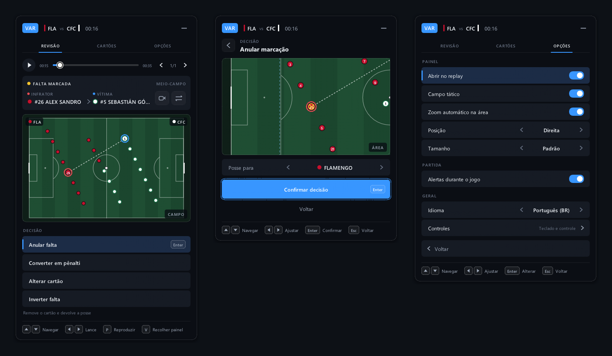

# PES 2021 - VAR Mod v4.4.3 (PT-BR & EN)


-0095D9?style=for-the-badge)


> **[Português (PT-BR)](#português-pt-br)** | **[English](#english)** | **[Build & Testes](#build--testes)**



---

## Português (PT-BR)

Árbitro de vídeo (**VAR**) para partidas offline do **eFootball PES 2021 (`v1.7.2.0`, Steam)**: revise o lance no **Replay Manual** e aplique ou reverta faltas, pênaltis, cartões e bolas paradas direto na engine. Módulo Sider independente (**DLL nativa x64 + Lua**), feito via engenharia reversa e compatível com **Sider 7.3+** e grandes patches (**BMPES 16.3**).

### Requisitos

- eFootball PES 2021 **`v1.7.2.0` da Steam** (outras versões do executável não são suportadas).
- **Sider 7.3+** com LuaJIT, sozinho ou dentro de um patch como o **BMPES 16.3**.
- Windows 10 ou 11 (x64).

### Instalação

1. Baixe o **`PES2021_VAR_Mod_v4.4.3.zip`** na página de [**Releases**](https://github.com/Joao-Spala/pes21-var-mod/releases/latest) e extraia em qualquer pasta.
2. Feche o jogo e rode o **`VAR_Mod_Gerenciar.bat`**. No menu, escolha **`1 - Instalar ou atualizar`**.
   - O instalador acha a pasta do Sider ou do BMPES (ou pede o caminho), copia os arquivos, ativa `luajit.ext.enabled = 1` e registra `lua.module = "var_mod.lua"` no `sider.ini`. Antes de mexer no `sider.ini`, ele cria um backup datado.
3. Abra o jogo pelo **Sider** (no BMPES, pelo atalho do próprio patch). A DLL só carrega na primeira partida (ou ao abrir o menu do Sider), então a abertura do jogo não fica mais lenta.

**Instalação manual:** copie `modules\var_mod.lua` para `<pasta do sider>\modules\` e `modules\var_mod\var_core.dll` para `<pasta do sider>\modules\var_mod\`. Depois adicione ao `sider.ini`:

```ini
luajit.ext.enabled = 1
lua.module = "var_mod.lua"
```

**Atualizar:** rode o instalador da versão nova e escolha a opção 1 de novo. **Desativar sem apagar:** opção 3. **Remover tudo:** opção 4 (apaga os arquivos e a linha `lua.module` do mod, e mantém `luajit.ext.enabled = 1`, que outros módulos do Sider também usam).

### Como usar

1. Jogue uma partida **offline** (Exibição, Master Liga, Rumo ao Estrelato ou Copas).
2. Num lance polêmico, **pause** e abra o **Replay Manual**. O painel VAR abre sozinho na lateral.
3. Na aba **`REVISÃO`**, escolha o lance na barra de lances (clique, ou use `[` e `]`). O painel leva o replay até o momento e já preenche infrator, vítima, local e zona.
4. Escolha a decisão: marcar falta ou pênalti, anular, converter, inverter, alterar cartão ou bola parada. Ajuste infrator, cartão, time e local com as setas esquerda e direita ou com o mouse (clique no campo tático para mover a cobrança). **`Enter`** leva ao botão Confirmar e um segundo **`Enter`** confirma.
5. Para corrigir cartões sem lance associado, use a aba **`CARTÕES`**: escolha o jogador e defina o cartão exato.
6. As decisões vão para o **pool de decisões**. Você pode juntar uma decisão de lance com vários ajustes de cartão. Cada item tem `[X]` para remover, e **`Delete`** limpa tudo.
7. **Saia do replay** e volte ao jogo. O pool inteiro é aplicado na engine de uma vez e um aviso confirma a decisão.

Idioma (Português ou English) e remap de atalhos ficam na aba **`OPÇÕES`**. No menu do Sider, a tecla **`7`** liga e desliga o VAR e a **`8`** mostra a telemetria ao vivo.

### Atalhos padrão (todos remapeáveis em `OPÇÕES > Controles`)

| Ação | Teclado | Controle |
|---|---|---|
| Abrir ou recolher o painel | `V` ou `F7` | `R3` |
| Confirmar | `Enter` | |
| Voltar | `Esc` ou `Backspace` | |
| Limpar pool | `Delete` | |
| Aba anterior / próxima | `Page Up` ou `Q` / `Page Down` ou `E` | |
| Inverter / trocar time | `Tab` | |
| Lance anterior / próximo | `[` / `]` | |
| Play / Pause do replay | `P` | |
| Navegar | Setas ou `W` `A` `S` `D` | |
| Telemetria | `F10` | |

O controle só abre e recolhe o painel. Ele continua controlando o replay normalmente. Enquanto o painel está em foco, teclado e mouse não chegam ao jogo.

### Funcionalidades

- **Painel VAR no Replay Manual**: abre ao entrar no replay da pausa, com barra de lances clicável, `Seek` nativo do replay 3D, `Play / Pause` e foco da câmera no infrator, na vítima ou na bola.
- **Detecção de lances a 60 Hz**: carrinhos, quedas, divididas, trancos e os eventos oficiais de falta, pênalti, cartão e vantagem viram marcadores na barra do replay, com infrator, vítima, local e zona (`DENTRO` ou `FORA DA ÁREA`) já preenchidos.
- **Pool de decisões compostas**: junte numa mesma revisão uma decisão de lance (no máximo 1 falta ou reinício por vez) e quantos ajustes de cartão quiser. Editar o mesmo lance de novo substitui a edição anterior, e lances diferentes do mesmo jogador ficam lado a lado. Tudo é aplicado de uma vez, em ordem, ao sair do replay.
- **Decisões aplicadas na engine (`MatchFSM`)**: anular falta ou pênalti, converter em pênalti, inverter falta, falta ou pênalti retroativo, aplicar ou retirar cartão de qualquer jogador e bola parada (escanteio, tiro de meta ou lateral), inclusive com o cobrador já posicionado (`SetPlayReady`). O cartão aplicado pelo VAR nunca é contado duas vezes pela engine.
- **Nomes, números e uniformes reais**: lidos da memória do jogo (`MatchRoster`), incluindo substituições ao vivo, avatar do Rumo ao Estrelato e uniformes licenciados ou editados (BMPES). Se o elenco não puder ser lido, o painel mostra `CASA` / `FORA`.
- **Campo tático 2D**: escala `1:1` com zoom automático na área, linha do penúltimo defensor, contato infrator x vítima e clique no gramado para mover o local da cobrança.
- **Atalhos e idioma**: remap de cada ação com 2 teclas, troca automática em conflito e proteção contra ficar sem atalho essencial. Interface em **Português (BR)** ou **English**, trocada na hora.
- **Leve e seguro**: DLL de ~910 KB, hook nativo em `GrSwapChain::Present0` (sem dispositivo DX11 extra), texto nítido de 720p a 4K, somente partidas offline e nenhum arquivo do jogo alterado.

### Solução de problemas

- **O menu do Sider mostra `Status: ERRO (...)` no VAR Mod:** a DLL não carregou. A mensagem entre parênteses diz o motivo (arquivo não encontrado, falha ao carregar ou falha ao iniciar). Confira se `var_core.dll` está em `<pasta do sider>\modules\var_mod\`, se `luajit.ext.enabled = 1` está no `sider.ini` e veja o `sider.log`.
- **O painel não abre no replay:** confirme que a partida é offline e que o VAR está ligado (tecla `7` no menu do Sider). Use `V`, `F7` ou `R3` para reabrir o painel recolhido.
- **Algo deu errado numa partida:** o log fica em `<pasta do sider>\modules\var_mod\var_core.log`. Ele é recriado a cada abertura do jogo, então copie o arquivo antes de abrir o jogo de novo e anexe numa [issue](https://github.com/Joao-Spala/pes21-var-mod/issues).
- **Configuração:** atalhos, idioma e estado ligado/desligado ficam em `<pasta do sider>\modules\var_mod\var_mod.ini`. Apagar o arquivo restaura o padrão.

---

## English

Video assistant referee (**VAR**) for **eFootball PES 2021 (`v1.7.2.0`, Steam)** offline matches: review the play in the **Manual Replay** and apply or overturn fouls, penalties, cards and set pieces straight in the engine. Standalone Sider module (**native x64 DLL + Lua**), built via reverse engineering and compatible with **Sider 7.3+** and major patches (**BMPES 16.3**).

### Requirements

- eFootball PES 2021 **Steam `v1.7.2.0`** (other executable versions are not supported).
- **Sider 7.3+** with LuaJIT, standalone or inside a patch such as **BMPES 16.3**.
- Windows 10 or 11 (x64).

### Installation

1. Download **`PES2021_VAR_Mod_v4.4.3.zip`** from the [**Releases**](https://github.com/Joao-Spala/pes21-var-mod/releases/latest) page and extract it anywhere.
2. Close the game and run **`VAR_Mod_Gerenciar.bat`**. In the menu, pick **`1 - Instalar ou atualizar`** (install or update).
   - The installer finds your Sider or BMPES folder (or asks for the path), copies the files, enables `luajit.ext.enabled = 1` and registers `lua.module = "var_mod.lua"` in `sider.ini`. It makes a timestamped backup of `sider.ini` first.
3. Launch the game through **Sider** (for BMPES, through the patch launcher). The DLL only loads on the first match (or when the Sider menu is opened), so game startup is not slowed down.

**Manual install:** copy `modules\var_mod.lua` to `<sider folder>\modules\` and `modules\var_mod\var_core.dll` to `<sider folder>\modules\var_mod\`. Then add to `sider.ini`:

```ini
luajit.ext.enabled = 1
lua.module = "var_mod.lua"
```

**Update:** run the new version's installer and pick option 1 again. **Disable without deleting:** option 3. **Remove everything:** option 4 (deletes the files and the mod's `lua.module` line, and keeps `luajit.ext.enabled = 1`, which other Sider modules also use).

### How to use

1. Play an **offline** match (Exhibition, Master League, Become a Legend or Cups).
2. On a controversial play, **pause** and open the **Manual Replay**. The VAR panel opens by itself on the side.
3. In the **`REVIEW`** tab, pick the play on the incident bar (click it, or use `[` and `]`). The panel seeks the replay to that moment and fills in offender, fouled player, spot and zone.
4. Choose the decision: give a foul or penalty, overturn, upgrade, reverse, change the card or award a set piece. Adjust offender, card, team and spot with the left and right arrows or the mouse (click the tactical pitch to move the restart). **`Enter`** jumps to the Confirm button and a second **`Enter`** confirms.
5. To fix cards with no play attached, use the **`CARDS`** tab: pick the player and set the exact card count.
6. Decisions go into the **decision pool**. You can combine one play decision with several card edits. Each item has an `[X]` to remove it, and **`Delete`** clears everything.
7. **Leave the replay** and resume the match. The whole pool is applied to the engine at once and a banner confirms the decision.

Language (Português or English) and shortcut remapping live in the **`OPTIONS`** tab. In the Sider menu, key **`7`** turns the VAR on or off and **`8`** shows live telemetry.

### Default shortcuts (all remappable in `OPTIONS > Controls`)

| Action | Keyboard | Gamepad |
|---|---|---|
| Open or collapse the panel | `V` or `F7` | `R3` |
| Confirm | `Enter` | |
| Back | `Esc` or `Backspace` | |
| Clear pool | `Delete` | |
| Previous / next tab | `Page Up` or `Q` / `Page Down` or `E` | |
| Swap / switch team | `Tab` | |
| Previous / next incident | `[` / `]` | |
| Replay Play / Pause | `P` | |
| Navigate | Arrow keys or `W` `A` `S` `D` | |
| Telemetry | `F10` | |

The gamepad only opens and collapses the panel and keeps controlling the replay. While the panel is focused, keyboard and mouse never reach the game.

### Features

- **VAR panel in the Manual Replay**: opens when you enter the pause menu replay, with a clickable incident bar, native 3D replay `Seek`, `Play / Pause` and camera focus on the offender, the fouled player or the ball.
- **60 Hz incident detection**: slide tackles, falls, challenges, shoulder charges and the official foul, penalty, card and advantage events become markers on the replay bar, with offender, fouled player, spot and zone (`INSIDE` or `OUTSIDE THE BOX`) already filled in.
- **Composite decision pool**: combine one play decision (at most 1 foul or restart at a time) with as many card edits as you need in the same review. Editing the same play again replaces the previous edit, and different plays of the same player stay side by side. Everything is applied at once, in order, when you leave the replay.
- **Decisions applied in the engine (`MatchFSM`)**: overturn a foul or penalty, upgrade to penalty, reverse a foul, retroactive free kick or penalty, show or remove a card for any player and set pieces (corner, goal kick or throw-in), including when the kicker is already standing over the ball (`SetPlayReady`). A card given by the VAR is never counted twice by the engine.
- **Real names, numbers and kits**: read from game memory (`MatchRoster`), including live substitutions, Become a Legend avatar and licensed or edited kits (BMPES). If the squad cannot be read, the panel shows `HOME` / `AWAY`.
- **2D tactical pitch**: `1:1` scale with automatic box zoom, second-to-last defender line, offender vs fouled contact and click-to-move restart spot.
- **Shortcuts and language**: remap every action with 2 keys, automatic swap on conflict and a guard that never leaves an essential action unbound. UI in **English** or **Português (BR)**, switched instantly.
- **Light and safe**: ~910 KB DLL, native `GrSwapChain::Present0` hook (no extra DX11 device), crisp text from 720p to 4K, offline matches only and no game file modified.

### Troubleshooting

- **The Sider menu shows `Status: ERROR (...)` for the VAR Mod:** the DLL did not load. The text in brackets gives the reason (file not found, load failure or start failure). Check that `var_core.dll` is in `<sider folder>\modules\var_mod\`, that `luajit.ext.enabled = 1` is in `sider.ini`, and look at `sider.log`.
- **The panel does not open in the replay:** make sure the match is offline and the VAR is on (key `7` in the Sider menu). Use `V`, `F7` or `R3` to reopen a collapsed panel.
- **Something went wrong in a match:** the log is at `<sider folder>\modules\var_mod\var_core.log`. It is recreated every time the game starts, so copy it before relaunching and attach it to an [issue](https://github.com/Joao-Spala/pes21-var-mod/issues).
- **Settings:** shortcuts, language and on/off state are stored in `<sider folder>\modules\var_mod\var_mod.ini`. Deleting it restores the defaults.

---

## Build & Testes

Requer **LLVM-MinGW** (`x86_64-w64-mingw32-clang++`) ou **MinGW-w64 UCRT x64**. O build gera o pacote em `dist/` e roda a suíte de testes.

```powershell
powershell -ExecutionPolicy Bypass -File native\build.ps1
$env:PES2021_EXE = "C:\Program Files (x86)\Steam\steamapps\common\eFootball PES 2021\PES2021.exe"  # opcional: valida os AOBs no executável real
$env:VAR_HUD_SNAPSHOT_DIR = "$env:TEMP\var_hud"; native\build_tmp\test_var_core.exe                  # opcional: capturas do painel
```

Notas de engenharia reversa (structs, hooks, AOBs e a máquina de estados da partida) em [`re_notes/`](re_notes). Histórico de versões no [`CHANGELOG.md`](CHANGELOG.md). Projeto independente, sem afiliação com a Konami. Nenhum arquivo do jogo é distribuído ou alterado.

## License

[MIT](LICENSE). Inclui [Dear ImGui](https://github.com/ocornut/imgui) ([MIT](native/third_party/imgui/LICENSE.txt)).
