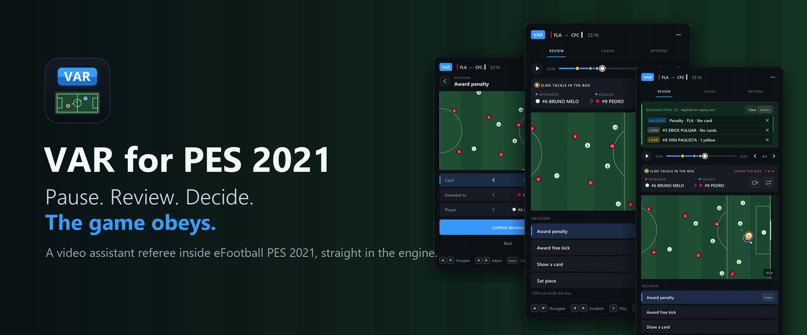
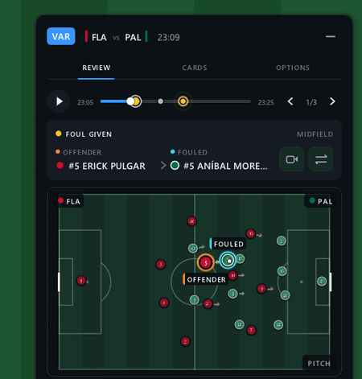
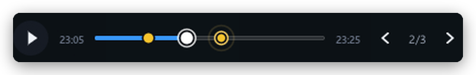
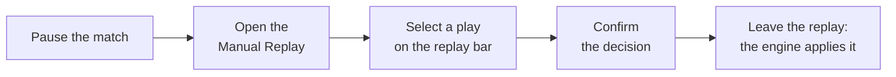
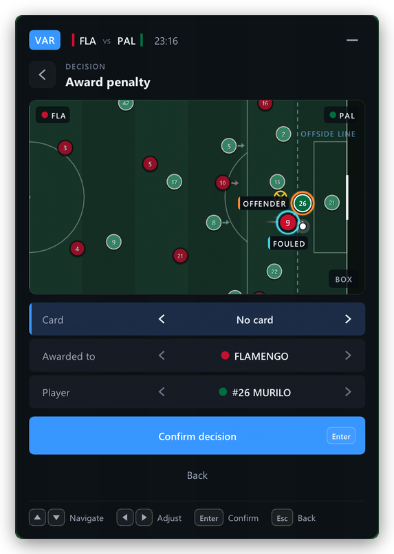
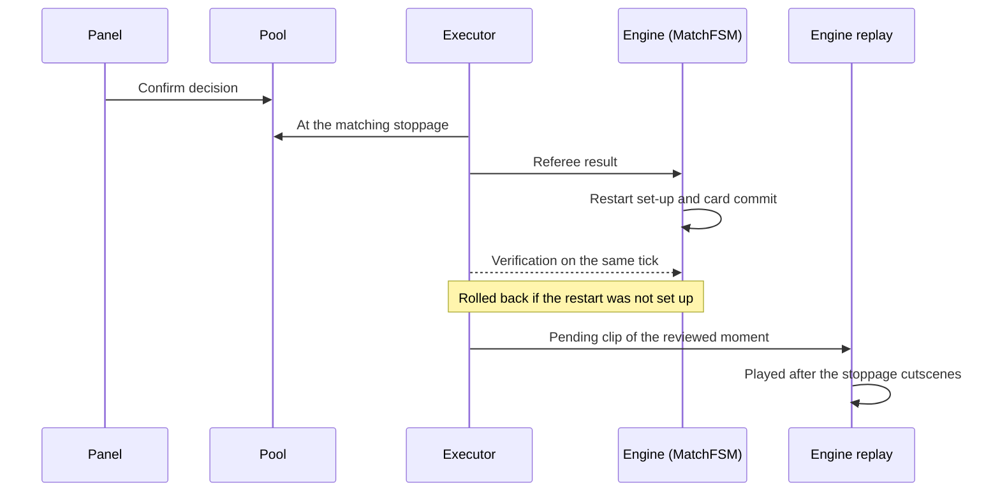

<div align="center">




-0095D9?style=for-the-badge)


**English** · [Português (BR)](README.pt-BR.md) · [Support](#support-the-project)

### [Download the latest release](https://github.com/Joao-Spala/pes21-var-mod/releases/latest)

[](https://ko-fi.com/AlfaceJao)

</div>

---

## Overview

VAR for PES 2021 is a video review module for offline matches of eFootball PES 2021 (Steam `v1.7.2.0`). It adds a review panel to the Manual Replay. Decisions confirmed there are applied by the game engine itself: restarts, cards and sendings off follow the engine's own flow.

It ships as a Sider module: a native x64 DLL and a Lua script.

## Demo

<p align="center"></p>

<p align="center"><sub>Review panel during the Manual Replay. The tactical pitch follows the replay frame by frame and the gold marker indicates the play with the highest missed-foul score.</sub></p>

## Features

| Area | Description |
| --- | --- |
| **Incident detection** | The match is sampled at 60 Hz. Slide tackles, standing tackles, shoulder charges, falls and simulation are marked on the replay bar together with the referee's fouls, cards and advantages, each with offender, fouled player, location and zone. |
| **Missed-foul indicator** | Plays the referee did not penalize are scored by challenge type, whether the opponent went down from the contact, location relative to the box and contact distance. The highest score is highlighted on the replay bar and labelled on the incident card. |
| **Decisions** | Award a foul or penalty on an earlier play, overturn a foul or penalty, upgrade to penalty, reverse a foul, edit any player's cards and award a corner, goal kick or throw-in. |
| **Decision pool** | One play decision and up to 32 card edits, applied together and in order when leaving the replay. |
| **Engine integration** | Decisions go through the match state machine (`MatchFSM`) and the engine's own card commit. If the engine does not set up the restart, every change made on that tick is rolled back. |
| **Replay after the decision** | For a foul or penalty given with the ball in play, the engine replays the reviewed moment after the stoppage cutscenes, through its own pending clip mechanism. Can be disabled. |
| **Tactical pitch** | Automatic framing (play or penalty box), shirt numbers, heading arrows, 1.5 s trails for the two players involved and the ball, attack direction per team, offside line and restart location. |
| **Replay camera** | Selecting a play on the replay bar moves the 3D replay camera to that frame. |
| **Player identity** | Names, numbers and kits are read from game memory, including patch-edited data. Cards and fouls follow the player, not the position, across substitutions. |
| **Interface** | PT-BR and English. Scales from 720p to 4K, ultrawide and 4:3, in three sizes. Keyboard and mouse inside the panel. |

## Detail

<table>
<tr>
<td width="50%"></td>
<td><b>Replay bar.</b> Markers for official decisions and detected incidents. The gold marker is the missed-foul indicator.</td>
</tr>
<tr>
<td></td>
<td><b>Incident card.</b> Incident type, distance to the box, offender (orange) and fouled player (cyan).</td>
</tr>
<tr>
<td></td>
<td><b>Tactical pitch.</b> Positions at the replay frame, heading arrows, trails, offside line and role labels.</td>
</tr>
</table>

## Workflow



The panel opens automatically in the Manual Replay. Detected plays come with offender, fouled player, location and zone already filled in and can be adjusted before confirming. Confirmed decisions are stored in the decision pool and applied when the replay is closed.

## Screenshots

<table>
<tr>
<td align="center" width="33%"><br><b>Review</b><br><sub>Replay bar, incident card and tactical pitch.</sub></td>
<td align="center" width="33%"><br><b>Decision</b><br><sub>Card, restart team, player and restart location.</sub></td>
<td align="center" width="33%"><br><b>Decision pool</b><br><sub>Pending decisions, applied when leaving the replay.</sub></td>
</tr>
<tr>
<td align="center"><br><b>Cards</b><br><sub>All 22 players with names and numbers.</sub></td>
<td align="center"><br><b>Options</b><br><sub>Panel, match and language settings.</sub></td>
<td align="center"><br><b>Controls</b><br><sub>Two keys per action.</sub></td>
</tr>
</table>

## Requirements

| Item | Version |
| --- | --- |
| Game | eFootball PES 2021 `v1.7.2.0` (Steam). Other executable versions are not supported. |
| Sider | 7.3 or later with LuaJIT, standalone or inside a patch |
| System | Windows 10 or 11, x64 |

## Installation

1. Download **`PES2021_VAR_Mod_v4.4.10.zip`** from [Releases](https://github.com/Joao-Spala/pes21-var-mod/releases/latest) and extract it.
2. With the game closed, run **`VAR_Mod_Gerenciar.bat`** and choose **`1 - Instalar ou atualizar`** (install or update).
3. Start the game through Sider (or through the patch launcher).

The installer locates Sider (or asks for its path), backs up `sider.ini` before changing it and does nothing while the game is running. The DLL is loaded on the first match.

<details>
<summary><b>Installer options and manual installation</b></summary>

| Option | Action |
| --- | --- |
| **1 - Install or update** | Copies the files and enables the mod in `sider.ini` |
| **2 - Enable** | Enables the mod without copying files |
| **3 - Disable** | Disables the mod and keeps the files |
| **4 - Uninstall** | Keeps `var_mod.ini` next to `sider.ini`, removes the files and the mod entry, keeps `luajit.ext.enabled = 1` |

**Manual installation:** copy `modules\var_mod.lua` to `<sider folder>\modules\` and `modules\var_mod\var_core.dll` to `<sider folder>\modules\var_mod\`, then add to `sider.ini`:

```ini
lua.enabled = 1
luajit.ext.enabled = 1
lua.module = "var_mod.lua"
```

</details>

## Options

Settings are saved in `<sider folder>\modules\var_mod\var_mod.ini`.

| Option | Default |
| --- | --- |
| Open in replay | On |
| Tactical pitch | On |
| Auto box zoom | On |
| Position | Right |
| Size (Compact, Default, Large) | Default |
| Live alerts | On |
| Replay the play after the decision | On |
| Language | Português (BR) |
| Controls | Two keys per action, remappable |

## Shortcuts

| Action | Keyboard | Gamepad |
| --- | --- | --- |
| Open or collapse the panel | `V` or `F7` | `R3` |
| Confirm / Back | `Enter` / `Esc` or `Backspace` | |
| Previous / next tab | `Page Up` or `Q` / `Page Down` or `E` | |
| Previous / next incident | `[` / `]` | |
| Swap roles or switch team | `Tab` | |
| Replay play / pause | `P` | |
| Navigate | Arrow keys or `W` `A` `S` `D` | |
| Clear the pool | `Delete` | |
| Telemetry | `F10` | |

All shortcuts can be changed in **OPTIONS > Controls**. While the panel has focus, keyboard and mouse input does not reach the game. In the Sider menu, `7` toggles the mod and `8` shows live telemetry.

## Limitations

- Supports only the Steam executable `v1.7.2.0`.
- Offline matches only: Exhibition, Master League, Become a Legend and Cups. Network, DRM and online modes are not touched.
- A decision applies to the stoppage in which it was made. Goals cannot be overturned.
- The replay after the decision requires a foul or penalty given with the ball in play and the reviewed moment still in the game's replay memory (about 11 s of play). The engine's own instant replay may play first.
- The gamepad opens and collapses the panel and controls the replay. Navigation inside the panel uses keyboard and mouse.

## Troubleshooting

| Symptom | Action |
| --- | --- |
| Sider menu shows `Status: ERROR (...)` | The DLL did not load. Check that `var_core.dll` is in `<sider folder>\modules\var_mod\`, that `lua.enabled = 1` and `luajit.ext.enabled = 1` are set in `sider.ini`, and check `sider.log`. |
| The panel does not open in the replay | Confirm the match is offline and the mod is enabled (`7` in the Sider menu). `V`, `F7` or `R3` reopen a collapsed panel. |
| No replay after a decision | It applies only to fouls and penalties given with the ball in play and can be disabled in **OPTIONS**. Otherwise a `Decision replay: ...` line in the log gives the reason. |
| Unexpected behaviour in a match | The log is `<sider folder>\modules\var_mod\var_core.log` and is recreated at every game start. Copy it before restarting the game and attach it to an [issue](https://github.com/Joao-Spala/pes21-var-mod/issues). |
| Reset settings | Delete `<sider folder>\modules\var_mod\var_mod.ini`. |

---

## Technical overview



| | |
| --- | --- |
| **Binary** | C++20 x64 DLL, about 780 KB. One render hook on `GrSwapChain::Present0`, no additional DX11 device, no UI work outside the replay. |
| **Cost** | Measured on the real code paths in a benchmark: 3 to 6 µs per simulation tick and 2 µs per frame. Match history of 30 s (about 0.87 MB). |
| **Safety** | Hooks are installed with the other threads suspended. Writes go only to validated structures. Includes a fix for an engine allocator fault that crashed the game after the final whistle. |
| **Tests** | 23 suites, including contract checks against the real executable and panel renders at 7 resolutions in both languages, also run under AddressSanitizer and UndefinedBehaviorSanitizer. |

Reverse engineering notes are in [`re_notes/`](re_notes). Release history is in [`CHANGELOG.md`](CHANGELOG.md).

## Build and tests

Requires **LLVM-MinGW UCRT x86_64** (`x86_64-w64-mingw32-clang++`). The build compiles the DLL, runs the tests and then stages the package in `dist/`.

```powershell
powershell -ExecutionPolicy Bypass -File native\build.ps1
```

With `PES2021_EXE` set, the tests check signatures and engine contracts against the executable. With `VAR_HUD_SNAPSHOT_DIR` set, they render the panel at 7 resolutions in both languages (and the replay sequence with `VAR_HUD_SEQUENCE`). `docs/assets/make_readme_art.py` builds the images of this README from those renders.

```powershell
$env:PES2021_EXE = "C:\Program Files (x86)\Steam\steamapps\common\eFootball PES 2021\PES2021.exe"
$env:VAR_HUD_SNAPSHOT_DIR = "$env:TEMP\var_hud"
$env:VAR_HUD_SEQUENCE = "1"
native\build_tmp\test_var_core.exe
python docs\assets\make_readme_art.py "$env:TEMP\var_hud"
```

---

## Support the project

The mod is free and open source. Donations are welcome and optional. Bug reports are equally useful.

[](https://ko-fi.com/AlfaceJao)

A Pix QR code is available in the [Portuguese README](README.pt-BR.md#apoie-o-projeto).

---

<div align="center">

Independent project, not affiliated with Konami. No game files are distributed or modified.

[MIT](LICENSE) · Includes [Dear ImGui](https://github.com/ocornut/imgui) ([MIT](native/third_party/imgui/LICENSE.txt))

</div>
