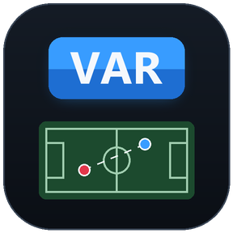

<div align="center">



# PES 2021 - VAR Mod

**Árbitro de vídeo para as partidas offline do eFootball PES 2021**<br>
**Video assistant referee for eFootball PES 2021 offline matches**


-0095D9?style=for-the-badge)


**[Português (PT-BR)](#português-pt-br)** · **[English](#english)** · **[Build & Testes / Build & Tests](#build--testes--build--tests)**

[**Baixar a última versão / Download the latest release**](https://github.com/Joao-Spala/pes21-var-mod/releases/latest)

</div>

<p align="center"></p>

---

## Português (PT-BR)

Módulo **Sider** independente (**DLL nativa x64 em C++20 + DirectX 11 + Dear ImGui**, menos de 1 MB, mais um módulo Lua) que coloca um **árbitro de vídeo** dentro do **eFootball PES 2021 (`v1.7.2.0`, Steam)**. Você revisa o lance no **Replay Manual** e aplica ou reverte faltas, pênaltis, cartões e bolas paradas **direto na engine do jogo**, como se o próprio árbitro tivesse decidido. Feito por engenharia reversa e compatível com **Sider 7.3+**, sozinho ou dentro dos grandes patches que usam o Sider.

Somente partidas offline. Nenhum arquivo do jogo é alterado e nada de rede, DRM ou modo online é tocado.

### Requisitos

| Item | Versão |
| --- | --- |
| **Jogo** | eFootball PES 2021 **`v1.7.2.0` da Steam** (outras versões do executável não são suportadas) |
| **Sider** | **7.3+** com LuaJIT, sozinho ou dentro de um patch que use o Sider |
| **Sistema** | Windows 10 ou 11 (x64) |

### Instalação

1. Baixe o **`PES2021_VAR_Mod_v4.4.7.zip`** em [**Releases**](https://github.com/Joao-Spala/pes21-var-mod/releases/latest) e extraia em qualquer pasta.
2. Feche o jogo e rode o **`VAR_Mod_Gerenciar.bat`**. No menu, escolha **`1 - Instalar ou atualizar`**.
3. Abra o jogo pelo **Sider** (num patch, pelo atalho do próprio patch).

O instalador acha a pasta do Sider ou do patch (ou pede o caminho), copia os arquivos, ativa `lua.enabled = 1` e `luajit.ext.enabled = 1` e registra `lua.module = "var_mod.lua"` no `sider.ini`, sempre com backup datado antes. Se o jogo estiver aberto, ele avisa e não mexe em nada. A DLL só carrega na primeira partida (ou ao abrir o menu do Sider), então a abertura do jogo não fica mais lenta.

| Opção do instalador | O que faz |
| --- | --- |
| **1 - Instalar ou atualizar** | Copia a versão nova e ativa o mod no `sider.ini` |
| **2 - Ativar** | Volta a ligar o mod sem copiar nada |
| **3 - Desativar** | Desliga o mod e mantém os arquivos |
| **4 - Desinstalar** | Guarda seu `var_mod.ini` (atalhos e idioma) ao lado do `sider.ini`, apaga os arquivos e a linha do mod e mantém `luajit.ext.enabled = 1`, que outros módulos também usam |

<details>
<summary><b>Instalação manual</b></summary>

Copie `modules\var_mod.lua` para `<pasta do sider>\modules\` e `modules\var_mod\var_core.dll` para `<pasta do sider>\modules\var_mod\`. Depois adicione ao `sider.ini`:

```ini
lua.enabled = 1
luajit.ext.enabled = 1
lua.module = "var_mod.lua"
```

</details>

### Como usar

1. Jogue uma partida **offline** (Exibição, Master Liga, Rumo ao Estrelato ou Copas).
2. Num lance polêmico, **pause** e abra o **Replay Manual**. O painel VAR abre sozinho na lateral.
3. Na aba **`REVISÃO`**, escolha o lance na barra de lances (clique, ou `[` e `]`). O replay vai até o momento e o painel já preenche infrator, vítima, local e zona.
4. Escolha a decisão e ajuste infrator, cartão, time e local com as setas ou o mouse (clique no campo tático para mover a cobrança).
5. Aperte **`Confirmar decisão`**. Um aviso confirma que ela foi para o **pool de decisões**, onde você pode juntar uma decisão de lance com vários ajustes de cartão.
6. **Saia do replay**. O pool inteiro é aplicado na engine de uma vez e um aviso mostra o resultado.

### Funcionalidades

| Área | O que faz |
| --- | --- |
| **Painel no Replay Manual** | Abas `REVISÃO`, `CARTÕES` e `OPÇÕES`, barra de lances clicável, `Seek` nativo do replay 3D, `Play / Pause` e foco da câmera no infrator, na vítima ou na bola. |
| **Detecção de lances a 60 Hz** | Carrinhos, botes, trancos, quedas, simulação e os eventos oficiais de falta, pênalti, cartão e vantagem viram marcadores com infrator, vítima, local e zona (`DENTRO` ou `FORA DA ÁREA`). A falta apitada depois de uma vantagem fica no momento do contato. |
| **Decisões** | Marcar falta ou pênalti num lance anterior, anular a falta ou o pênalti marcado, converter em pênalti, inverter a falta, alterar ou retirar cartão de qualquer jogador e bola parada (escanteio, tiro de meta ou lateral), inclusive com o cobrador já posicionado. |
| **Pool de decisões** | Uma decisão de lance mais até 32 ajustes de cartão, aplicados juntos e em ordem. Anular a falta atual e marcar uma falta anterior cabem no mesmo pacote. Uma decisão sobre uma parada que já passou nunca é aplicada fora de hora. |
| **Engine nativa (`MatchFSM`)** | O cartão passa pelo registro da própria engine, que conta uma vez só, e a expulsão sai pelo fluxo dela. Se a engine não montar a bola parada, o mod desfaz tudo o que escreveu naquele instante. |
| **Jogador certo, sempre** | Cartões e faltas seguem o jogador do lance, não a posição, mesmo depois de substituições. Nunca há terceiro amarelo nem segundo vermelho. |
| **Nomes, números e uniformes** | Lidos da memória do jogo, com substituições ao vivo, avatar do Rumo ao Estrelato e uniformes licenciados ou editados por patches. |
| **Campo tático 2D** | Escala real com zoom automático na área, lados corretos em cada tempo, contato infrator x vítima e clique para mover o local da cobrança. |
| **Atalhos e idioma** | Remap de cada ação com 2 teclas, troca automática em conflito, proteção contra ficar sem atalho essencial e interface em **Português (BR)** ou **English**, trocada na hora e salva. |

### Atalhos padrão

Todos remapeáveis em `OPÇÕES > Controles`.

| Ação | Teclado | Controle |
| --- | --- | --- |
| Abrir ou recolher o painel | `V` ou `F7` | `R3` |
| Confirmar | `Enter` | |
| Voltar | `Esc` ou `Backspace` | |
| Limpar pool | `Delete` | |
| Aba anterior / próxima | `Page Up` ou `Q` / `Page Down` ou `E` | |
| Inverter papéis / trocar time | `Tab` | |
| Lance anterior / próximo | `[` / `]` | |
| Play / Pause do replay | `P` | |
| Navegar | Setas ou `W` `A` `S` `D` | |
| Telemetria | `F10` | |

O controle só abre e recolhe o painel e continua controlando o replay normalmente. Enquanto o painel está em foco, teclado e mouse não chegam ao jogo. No menu do Sider, a tecla **`7`** liga e desliga o VAR e a **`8`** mostra a telemetria ao vivo.

### Interface e estabilidade

- **Visual de transmissão:** dark mode, selo `VAR`, cores dos times, avisos de decisão e confirmação animados e textos nítidos.
- **Qualquer resolução:** o painel ocupa a mesma fração da tela de 720p a 4K, em ultrawide, 4:3 e 5:4, com três tamanhos (`Compacto`, `Padrão`, `Grande`) por cima. Nomes longos e acentos (inclusive Latin Extended, como Modrić) cabem com reticências.
- **Leve:** um único hook em `GrSwapChain::Present0`, sem dispositivo DX11 extra, e nenhum trabalho de interface fora do replay.
- **Seguro:** escritas na memória do jogo só nas estruturas validadas e nos dois buffers que a engine usa, ganchos instalados com as outras threads congeladas, correção de um defeito do alocador do jogo que derrubava o PES depois do apito final, e suíte de testes validada com AddressSanitizer e UndefinedBehaviorSanitizer.

### Solução de problemas

| Sintoma | O que fazer |
| --- | --- |
| **Menu do Sider mostra `Status: ERRO (...)`** | A DLL não carregou e o texto diz o motivo. Confira se `var_core.dll` está em `<pasta do sider>\modules\var_mod\`, se `lua.enabled = 1` e `luajit.ext.enabled = 1` estão no `sider.ini` e veja o `sider.log`. |
| **O painel não abre no replay** | Confirme que a partida é offline e que o VAR está ligado (tecla `7` no menu do Sider). Use `V`, `F7` ou `R3` para reabrir o painel recolhido. |
| **Algo deu errado numa partida** | O log fica em `<pasta do sider>\modules\var_mod\var_core.log` e é recriado a cada abertura do jogo. Copie o arquivo antes de abrir o jogo de novo e anexe numa [issue](https://github.com/Joao-Spala/pes21-var-mod/issues). |
| **Voltar ao padrão** | Atalhos, idioma e estado ficam em `<pasta do sider>\modules\var_mod\var_mod.ini`. Apagar o arquivo restaura o padrão. |

---

## English

Standalone **Sider** module (**native x64 DLL in C++20 + DirectX 11 + Dear ImGui**, under 1 MB, plus a Lua module) that brings a **video assistant referee** to **eFootball PES 2021 (`v1.7.2.0`, Steam)**. Review the play in the **Manual Replay** and apply or overturn fouls, penalties, cards and set pieces **straight in the game engine**, as if the referee had made the call. Built through reverse engineering and compatible with **Sider 7.3+**, standalone or inside the major patches built on Sider.

Offline matches only. No game file is modified and nothing related to network, DRM or online modes is touched.

### Requirements

| Item | Version |
| --- | --- |
| **Game** | eFootball PES 2021 **Steam `v1.7.2.0`** (other executable versions are not supported) |
| **Sider** | **7.3+** with LuaJIT, standalone or inside a patch that uses Sider |
| **System** | Windows 10 or 11 (x64) |

### Installation

1. Download **`PES2021_VAR_Mod_v4.4.7.zip`** from [**Releases**](https://github.com/Joao-Spala/pes21-var-mod/releases/latest) and extract it anywhere.
2. Close the game and run **`VAR_Mod_Gerenciar.bat`**. In the menu, pick **`1 - Instalar ou atualizar`** (install or update).
3. Launch the game through **Sider** (with a patch, through the patch launcher).

The installer finds your Sider or patch folder (or asks for the path), copies the files, enables `lua.enabled = 1` and `luajit.ext.enabled = 1` and registers `lua.module = "var_mod.lua"` in `sider.ini`, always with a timestamped backup first. If the game is open, it says so and changes nothing. The DLL only loads on the first match (or when the Sider menu opens), so game startup is not slowed down.

| Installer option | What it does |
| --- | --- |
| **1 - Install or update** | Copies the new version and enables the mod in `sider.ini` |
| **2 - Enable** | Turns the mod back on without copying anything |
| **3 - Disable** | Turns the mod off and keeps the files |
| **4 - Uninstall** | Keeps your `var_mod.ini` (shortcuts and language) next to `sider.ini`, deletes the files and the mod's line and keeps `luajit.ext.enabled = 1`, which other modules also use |

<details>
<summary><b>Manual install</b></summary>

Copy `modules\var_mod.lua` to `<sider folder>\modules\` and `modules\var_mod\var_core.dll` to `<sider folder>\modules\var_mod\`. Then add to `sider.ini`:

```ini
lua.enabled = 1
luajit.ext.enabled = 1
lua.module = "var_mod.lua"
```

</details>

### How to use

1. Play an **offline** match (Exhibition, Master League, Become a Legend or Cups).
2. On a controversial play, **pause** and open the **Manual Replay**. The VAR panel opens by itself on the side.
3. In the **`REVIEW`** tab, pick the play on the incident bar (click it, or `[` and `]`). The replay seeks to that moment and the panel fills in offender, fouled player, spot and zone.
4. Choose the decision and adjust offender, card, team and spot with the arrow keys or the mouse (click the tactical pitch to move the restart).
5. Press **`Confirm decision`**. A toast confirms it went into the **decision pool**, where one play decision can be combined with several card edits.
6. **Leave the replay**. The whole pool is applied to the engine at once and a banner shows the result.

### Features

| Area | What it does |
| --- | --- |
| **Manual Replay panel** | `REVIEW`, `CARDS` and `OPTIONS` tabs, clickable incident bar, native 3D replay `Seek`, `Play / Pause` and camera focus on the offender, the fouled player or the ball. |
| **60 Hz incident detection** | Slide tackles, standing tackles, shoulder charges, falls, simulation and the official foul, penalty, card and advantage events become markers with offender, fouled player, spot and zone (`INSIDE` or `OUTSIDE THE BOX`). A foul whistled after an advantage sits at the moment of contact. |
| **Decisions** | Give a foul or penalty on an earlier play, overturn the foul or penalty given, upgrade to penalty, reverse the foul, change or remove any player's card and award a set piece (corner, goal kick or throw-in), even with the kicker already standing over the ball. |
| **Decision pool** | One play decision plus up to 32 card edits, applied together and in order. Overturning the current foul and giving an earlier one fit in the same pool. A decision about a stoppage that has already passed is never applied out of time. |
| **Native engine (`MatchFSM`)** | The card goes through the engine's own commit, which counts it once, and the sending off follows the engine's flow. If the engine does not set up the restart, the mod undoes everything it wrote at that moment. |
| **Always the right player** | Cards and fouls follow the player of the play, not the slot, even after substitutions. Never a third yellow or a second red. |
| **Names, numbers and kits** | Read from game memory, with live substitutions, Become a Legend avatar and licensed or patch-edited kits. |
| **2D tactical pitch** | True scale with automatic box zoom, correct sides in each half, offender vs fouled contact and click-to-move restart spot. |
| **Shortcuts and language** | Remap every action with 2 keys, automatic swap on conflict, a guard that never leaves an essential action unbound, and a UI in **English** or **Português (BR)**, switched instantly and saved. |

### Default shortcuts

All remappable in `OPTIONS > Controls`.

| Action | Keyboard | Gamepad |
| --- | --- | --- |
| Open or collapse the panel | `V` or `F7` | `R3` |
| Confirm | `Enter` | |
| Back | `Esc` or `Backspace` | |
| Clear pool | `Delete` | |
| Previous / next tab | `Page Up` or `Q` / `Page Down` or `E` | |
| Swap roles / switch team | `Tab` | |
| Previous / next incident | `[` / `]` | |
| Replay Play / Pause | `P` | |
| Navigate | Arrow keys or `W` `A` `S` `D` | |
| Telemetry | `F10` | |

The gamepad only opens and collapses the panel and keeps controlling the replay. While the panel is focused, keyboard and mouse never reach the game. In the Sider menu, key **`7`** turns the VAR on or off and **`8`** shows live telemetry.

### Interface and stability

- **Broadcast look:** dark mode, `VAR` badge, team colours, animated decision banners and confirmation toasts, crisp text.
- **Any resolution:** the panel takes the same share of the screen from 720p to 4K, ultrawide, 4:3 and 5:4, with three sizes (`Compact`, `Default`, `Large`) on top. Long names and accents (including Latin Extended, such as Modrić) fit with ellipses.
- **Light:** a single `GrSwapChain::Present0` hook, no extra DX11 device and no UI work outside the replay.
- **Safe:** game memory is only written in validated structures and in both buffers the engine uses, hooks are installed with the other threads frozen, a game allocator bug that crashed PES after the final whistle is fixed, and the test suite is validated under AddressSanitizer and UndefinedBehaviorSanitizer.

### Troubleshooting

| Symptom | What to do |
| --- | --- |
| **Sider menu shows `Status: ERROR (...)`** | The DLL did not load and the text gives the reason. Check that `var_core.dll` is in `<sider folder>\modules\var_mod\`, that `lua.enabled = 1` and `luajit.ext.enabled = 1` are in `sider.ini`, and look at `sider.log`. |
| **The panel does not open in the replay** | Make sure the match is offline and the VAR is on (key `7` in the Sider menu). Use `V`, `F7` or `R3` to reopen a collapsed panel. |
| **Something went wrong in a match** | The log is at `<sider folder>\modules\var_mod\var_core.log` and is recreated every time the game starts. Copy it before relaunching and attach it to an [issue](https://github.com/Joao-Spala/pes21-var-mod/issues). |
| **Back to defaults** | Shortcuts, language and on/off state live in `<sider folder>\modules\var_mod\var_mod.ini`. Deleting it restores the defaults. |

---

## Build & Testes / Build & Tests

Requer / Requires **LLVM-MinGW UCRT x86_64** (`x86_64-w64-mingw32-clang++`). O build compila a DLL, roda a suíte de testes e só então gera o pacote em `dist/` / The build compiles the DLL, runs the test suite and only then stages the package in `dist/`.

```powershell
powershell -ExecutionPolicy Bypass -File native\build.ps1
```

Saída / Output: `dist/modules/var_mod/var_core.dll`, `dist/modules/var_mod.lua` e/and `dist/VAR_Mod_Gerenciar.bat`.

Opcional / Optional:

```powershell
$env:PES2021_EXE = "C:\Program Files (x86)\Steam\steamapps\common\eFootball PES 2021\PES2021.exe"
$env:VAR_HUD_SNAPSHOT_DIR = "$env:TEMP\var_hud"
native\build_tmp\test_var_core.exe
```

Com `PES2021_EXE`, os testes conferem as assinaturas e os contratos da engine no executável real. Com `VAR_HUD_SNAPSHOT_DIR`, eles salvam capturas do painel em 7 resoluções e nos dois idiomas.<br>
With `PES2021_EXE`, the tests check the signatures and engine contracts against the real executable. With `VAR_HUD_SNAPSHOT_DIR`, they save panel snapshots at 7 resolutions in both languages.

Notas de engenharia reversa (structs, hooks, assinaturas e a máquina de estados da partida) em [`re_notes/`](re_notes) e histórico em [`CHANGELOG.md`](CHANGELOG.md). O logo é gerado por `docs/assets/make_logo.py`.<br>
Reverse engineering notes (structs, hooks, signatures and the match state machine) are in [`re_notes/`](re_notes) and the history is in [`CHANGELOG.md`](CHANGELOG.md). The logo is generated by `docs/assets/make_logo.py`.

Projeto independente, sem afiliação com a Konami. Nenhum arquivo do jogo é distribuído ou alterado.<br>
Independent project, not affiliated with Konami. No game file is distributed or modified.

## Licença / License

[MIT](LICENSE). Inclui / Includes [Dear ImGui](https://github.com/ocornut/imgui) ([MIT](native/third_party/imgui/LICENSE.txt)).
