<div align="center">

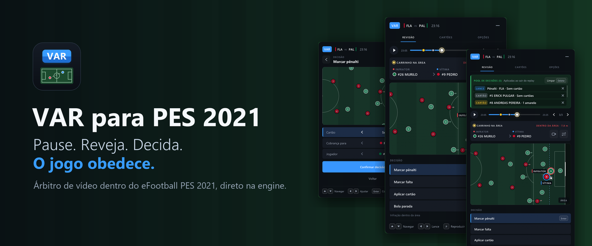


-0095D9?style=for-the-badge)


**[Português](#português)** · **[English](#english)** · **[Por dentro / Under the hood](#por-dentro--under-the-hood)** · **[Build](#build--testes--build--tests)**

### [Baixar a última versão / Download the latest release](https://github.com/Joao-Spala/pes21-var-mod/releases/latest)

</div>

---

## Português

### O lance que você não podia contestar

Todo mundo que joga PES já viveu isso. O atacante cai na área, o árbitro manda seguir, o replay mostra a chuteira do zagueiro no tornozelo e não resta nada além de aceitar. Ou o contrário: um amarelo para o jogador errado, um pênalti que não existiu, um carrinho por trás que passou batido.

O **VAR para PES 2021** coloca a última palavra nas suas mãos. Você pausa, abre o replay, escolhe o lance e decide. Não é uma tela por cima do jogo fingindo arbitrar. A decisão entra **na própria engine** do PES, que muda a cobrança, dá ou tira o cartão e expulsa ou devolve o jogador como se o árbitro tivesse decidido assim desde o começo.

### Três lances, três respostas

| Quando acontece isto | O VAR faz isto |
| --- | --- |
| **O pênalti que não foi marcado.** Seu atacante foi derrubado e o jogo seguiu. | Volte ao lance no replay e escolha **Marcar pênalti**. A partida vai para a marca da cal, com o cartão que você decidir. |
| **A marcação injusta.** O árbitro deu falta e amarelo num lance limpo. | Escolha **Anular falta**. A falta some, o cartão é retirado e a posse volta para o time certo. |
| **O cartão errado.** Era o segundo amarelo e o jogador ficou em campo, ou o contrário. | Ajuste o cartão de qualquer jogador na aba **CARTÕES**. A engine tira ou devolve o jogador na bola parada. |

### Do lance à decisão

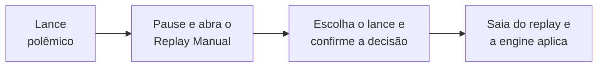

O painel encontra sozinho os momentos que importam. Ele acompanha a partida 60 vezes por segundo e marca na barra do replay carrinhos, botes, trancos, quedas e simulações, além das faltas, cartões e vantagens do árbitro. Cada marcador já chega com infrator, vítima, local e zona (dentro ou fora da área). Você confere, ajusta o que quiser e aperta **Confirmar decisão**. A decisão vai para o **pool de decisões** e, ao sair do replay, a engine aplica tudo de uma vez.

### O painel

<table>
<tr>
<td align="center" width="33%">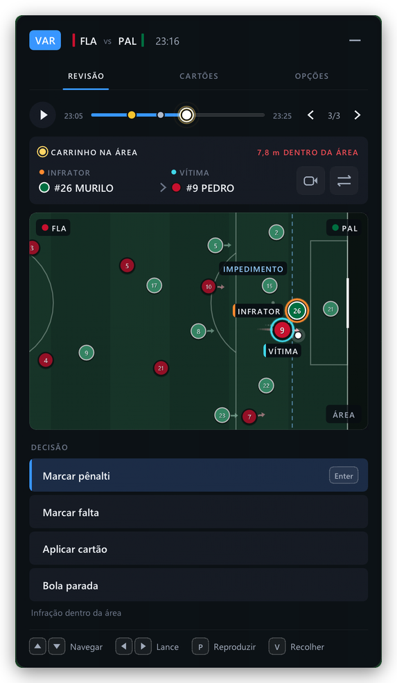<br><b>Revisão</b><br><sub>A barra de lances, o lance em foco e o campo tático com o contato entre infrator e vítima.</sub></td>
<td align="center" width="33%">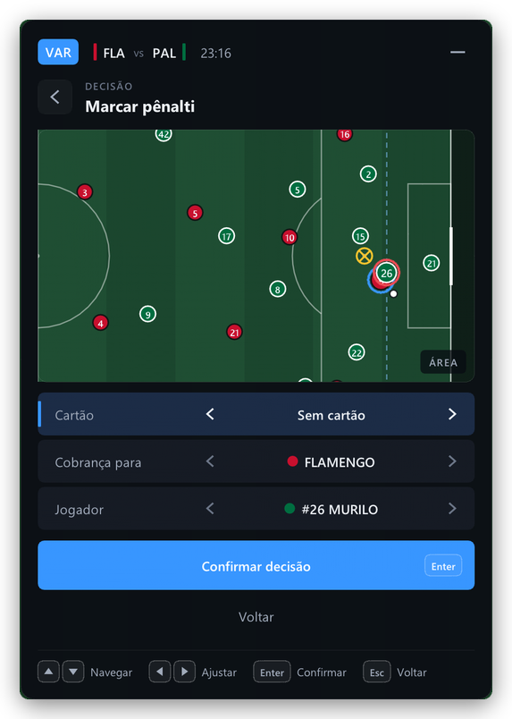<br><b>Decisão</b><br><sub>Ajuste jogador, cartão, time e local. Um clique no campo move a cobrança.</sub></td>
<td align="center" width="33%">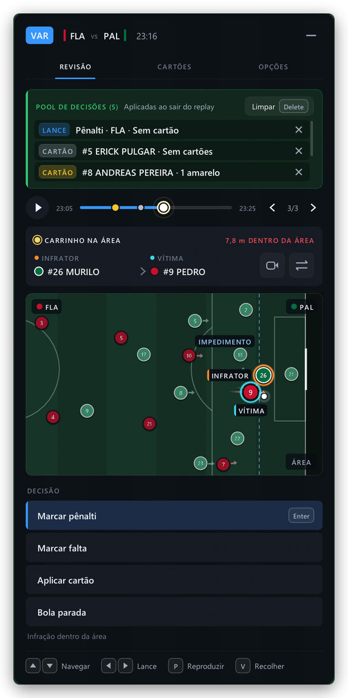<br><b>Pool de decisões</b><br><sub>Um lance e até 32 ajustes de cartão, aplicados juntos e em ordem ao sair do replay.</sub></td>
</tr>
<tr>
<td align="center">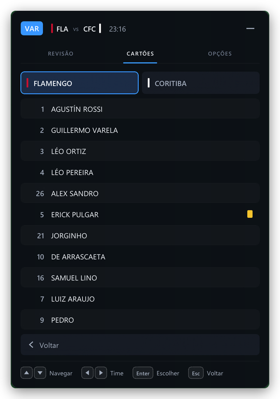<br><b>Cartões</b><br><sub>Os 22 jogadores com nomes e números reais. Corrija o cartão de qualquer um, mesmo sem lance.</sub></td>
<td align="center">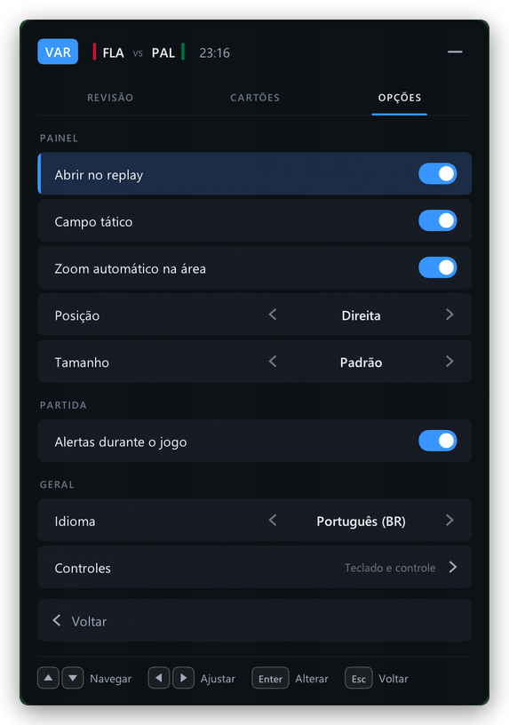<br><b>Opções</b><br><sub>Lado da tela, tamanho, campo tático, avisos e idioma, salvos para a próxima partida.</sub></td>
<td align="center">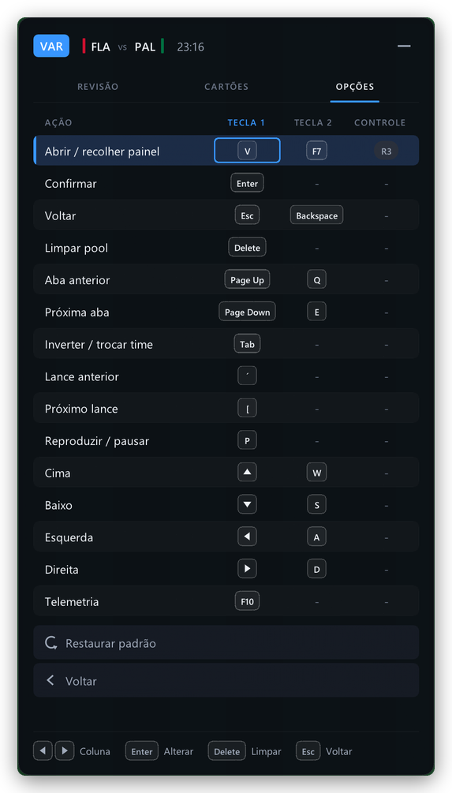<br><b>Controles</b><br><sub>Duas teclas por ação, troca automática em conflito e nenhum atalho essencial perdido.</sub></td>
</tr>
</table>

<p align="center">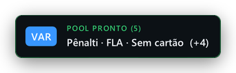<br><sub>Recolhido, o painel vira uma pílula que lembra o que vai ser aplicado.</sub></p>

### Ver, decidir, aplicar, lembrar

| | |
| --- | --- |
| **Ver** | Detecção de lances a 60 Hz com o modelo de contato da própria engine. A falta apitada depois de uma vantagem fica no momento do contato, não no apito. Nomes, números e uniformes vêm da memória do jogo, inclusive os editados por patches. |
| **Decidir** | Marcar falta ou pênalti num lance anterior, anular a falta ou o pênalti marcado, converter em pênalti, inverter a falta, ajustar cartões e dar escanteio, tiro de meta ou lateral, mesmo com o cobrador já posicionado. |
| **Aplicar** | O cartão passa pelo registro da própria engine, que conta uma vez só, e a expulsão sai pelo fluxo dela. Se o jogo não montar a cobrança, o mod desfaz tudo o que escreveu naquele instante. |
| **Lembrar** | Cartões e faltas seguem o jogador do lance, não a posição, mesmo depois de uma substituição. Uma decisão sobre uma parada que já passou nunca é aplicada fora de hora. |
| **Respeitar** | Nunca terceiro amarelo nem segundo vermelho. Nenhum arquivo do jogo é alterado. O painel ocupa a mesma fração da tela de 720p a 4K, em ultrawide e 4:3, nos tamanhos Compacto, Padrão e Grande. |

### Limites honestos

- Funciona só no **PES 2021 `v1.7.2.0` da Steam**. Outras versões do executável têm outros endereços e não são suportadas.
- **Só partidas offline**: Exibição, Master Liga, Rumo ao Estrelato e Copas. Nada de rede, DRM ou modo online é tocado.
- Não volta o jogo no tempo. Uma decisão vale para a parada em que foi tomada, e **gols não podem ser anulados**.
- O controle abre e recolhe o painel e continua controlando o replay. Dentro do painel, a navegação é por teclado e mouse.

### Instalação

1. Baixe o **`PES2021_VAR_Mod_v4.4.8.zip`** em [**Releases**](https://github.com/Joao-Spala/pes21-var-mod/releases/latest) e extraia em qualquer pasta.
2. Com o jogo fechado, rode o **`VAR_Mod_Gerenciar.bat`** e escolha **`1 - Instalar ou atualizar`**.
3. Abra o jogo pelo **Sider** (num patch, pelo atalho do próprio patch). Pronto.

O instalador acha o Sider sozinho (ou pergunta o caminho), faz backup datado do `sider.ini` antes de qualquer mudança e não mexe em nada com o jogo aberto. A DLL só carrega na primeira partida, então a abertura do jogo continua igual.

<details>
<summary><b>Opções do instalador, instalação manual e requisitos</b></summary>

| Opção | O que faz |
| --- | --- |
| **1 - Instalar ou atualizar** | Copia a versão nova e ativa o mod no `sider.ini` |
| **2 - Ativar** | Volta a ligar o mod sem copiar nada |
| **3 - Desativar** | Desliga o mod e mantém os arquivos |
| **4 - Desinstalar** | Guarda seu `var_mod.ini` (atalhos e idioma) ao lado do `sider.ini`, apaga os arquivos e a linha do mod e mantém `luajit.ext.enabled = 1`, que outros módulos também usam |

**Manual:** copie `modules\var_mod.lua` para `<pasta do sider>\modules\` e `modules\var_mod\var_core.dll` para `<pasta do sider>\modules\var_mod\`. Depois adicione ao `sider.ini`:

```ini
lua.enabled = 1
luajit.ext.enabled = 1
lua.module = "var_mod.lua"
```

**Requisitos:** PES 2021 `v1.7.2.0` (Steam), Sider 7.3+ com LuaJIT (sozinho ou dentro de um patch) e Windows 10 ou 11 x64.

</details>

### Atalhos

| Ação | Teclado | Controle |
| --- | --- | --- |
| Abrir ou recolher o painel | `V` ou `F7` | `R3` |
| Confirmar / Voltar | `Enter` / `Esc` ou `Backspace` | |
| Aba anterior / próxima | `Page Up` ou `Q` / `Page Down` ou `E` | |
| Lance anterior / próximo | `[` / `]` | |
| Inverter papéis ou trocar time | `Tab` | |
| Play / Pause do replay | `P` | |
| Navegar | Setas ou `W` `A` `S` `D` | |
| Limpar o pool | `Delete` | |
| Telemetria | `F10` | |

Todos remapeáveis em **OPÇÕES > Controles**. Enquanto o painel está em foco, teclado e mouse não chegam ao jogo. No menu do Sider, a tecla **`7`** liga e desliga o VAR e a **`8`** mostra a telemetria ao vivo.

<details>
<summary><b>Solução de problemas</b></summary>

| Sintoma | O que fazer |
| --- | --- |
| **O menu do Sider mostra `Status: ERRO (...)`** | A DLL não carregou e o texto diz o motivo. Confira se `var_core.dll` está em `<pasta do sider>\modules\var_mod\`, se `lua.enabled = 1` e `luajit.ext.enabled = 1` estão no `sider.ini` e veja o `sider.log`. |
| **O painel não abre no replay** | Confirme que a partida é offline e que o VAR está ligado (tecla `7` no menu do Sider). `V`, `F7` ou `R3` reabrem o painel recolhido. |
| **Algo deu errado numa partida** | O log fica em `<pasta do sider>\modules\var_mod\var_core.log` e é recriado a cada abertura do jogo. Copie antes de abrir de novo e anexe numa [issue](https://github.com/Joao-Spala/pes21-var-mod/issues). |
| **Voltar ao padrão** | Apague `<pasta do sider>\modules\var_mod\var_mod.ini`. |

</details>

---

## English

<div align="center"></div>

### The call you could never challenge

Everyone who plays PES has been there. Your striker goes down in the box, the referee waves play on, the replay shows the defender's boot on the ankle and there is nothing left but to accept it. Or the opposite: a yellow for the wrong player, a penalty that never happened, a tackle from behind that went unpunished.

**VAR for PES 2021** puts the final word in your hands. Pause, open the replay, pick the play and decide. It is not an overlay pretending to referee. The decision goes **into the PES engine itself**, which changes the restart, gives or removes the card and sends off or brings back the player as if the referee had called it that way from the start.

### Three plays, three answers

| When this happens | The VAR does this |
| --- | --- |
| **The penalty that was not given.** Your striker was brought down and play went on. | Go back to the play in the replay and pick **Award penalty**. The match goes to the spot, with the card you choose. |
| **The unfair call.** The referee gave a foul and a yellow on a clean tackle. | Pick **Overturn foul**. The foul disappears, the card is removed and possession goes back to the right team. |
| **The wrong card.** It was a second yellow and the player stayed on, or the other way round. | Fix any player's card in the **CARDS** tab. The engine removes or restores the player at the stoppage. |

### From play to decision

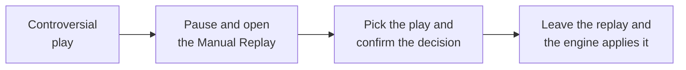

The panel finds the moments that matter by itself. It follows the match 60 times per second and marks slide tackles, standing tackles, shoulder charges, falls and simulation on the replay bar, along with the referee's fouls, cards and advantages. Every marker arrives with offender, fouled player, spot and zone (inside or outside the box). Check it, adjust anything and press **Confirm decision**. The decision goes into the **decision pool** and, when you leave the replay, the engine applies everything at once.

### The panel

<table>
<tr>
<td align="center" width="33%"><br><b>Review</b><br><sub>The incident bar, the play in focus and the tactical pitch with the contact between offender and fouled player.</sub></td>
<td align="center" width="33%"><br><b>Decision</b><br><sub>Adjust player, card, team and spot. One click on the pitch moves the restart.</sub></td>
<td align="center" width="33%">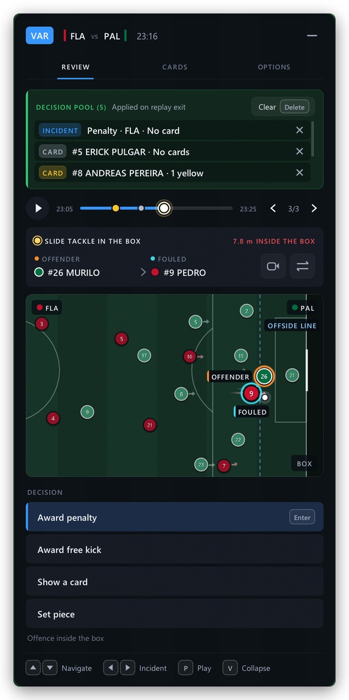<br><b>Decision pool</b><br><sub>One play and up to 32 card edits, applied together and in order when you leave the replay.</sub></td>
</tr>
<tr>
<td align="center"><br><b>Cards</b><br><sub>All 22 players with real names and numbers. Fix anyone's card, even with no play attached.</sub></td>
<td align="center">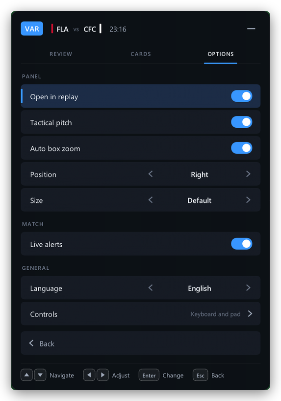<br><b>Options</b><br><sub>Screen side, size, tactical pitch, alerts and language, saved for the next match.</sub></td>
<td align="center"><br><b>Controls</b><br><sub>Two keys per action, automatic swap on conflict and no essential shortcut ever lost.</sub></td>
</tr>
</table>

<p align="center"><br><sub>Collapsed, the panel becomes a pill that reminds you what is about to be applied.</sub></p>

### See, decide, apply, remember

| | |
| --- | --- |
| **See** | 60 Hz incident detection using the engine's own contact model. A foul whistled after an advantage sits at the moment of contact, not at the whistle. Names, numbers and kits come from game memory, including patch-edited ones. |
| **Decide** | Award a foul or penalty on an earlier play, overturn the foul or penalty given, upgrade to penalty, reverse the foul, edit cards and award a corner, goal kick or throw-in, even with the kicker already over the ball. |
| **Apply** | The card goes through the engine's own commit, which counts it once, and the sending off follows the engine's flow. If the game does not set up the restart, the mod undoes everything it wrote at that moment. |
| **Remember** | Cards and fouls follow the player of the play, not the slot, even after a substitution. A decision about a stoppage that has already passed is never applied out of time. |
| **Respect** | Never a third yellow or a second red. No game file is modified. The panel takes the same share of the screen from 720p to 4K, ultrawide and 4:3, in Compact, Default and Large sizes. |

### Honest limits

- It only works on **Steam PES 2021 `v1.7.2.0`**. Other executable versions use other addresses and are not supported.
- **Offline matches only**: Exhibition, Master League, Become a Legend and Cups. Nothing related to network, DRM or online modes is touched.
- It does not rewind the match. A decision applies to the stoppage it was made in, and **goals cannot be overturned**.
- The gamepad opens and collapses the panel and keeps controlling the replay. Inside the panel, navigation is keyboard and mouse.

### Installation

1. Download **`PES2021_VAR_Mod_v4.4.8.zip`** from [**Releases**](https://github.com/Joao-Spala/pes21-var-mod/releases/latest) and extract it anywhere.
2. With the game closed, run **`VAR_Mod_Gerenciar.bat`** and pick **`1 - Instalar ou atualizar`** (install or update).
3. Launch the game through **Sider** (with a patch, through the patch launcher). Done.

The installer finds Sider by itself (or asks for the path), makes a timestamped backup of `sider.ini` before any change and touches nothing while the game is open. The DLL only loads on the first match, so game startup stays the same.

<details>
<summary><b>Installer options, manual install and requirements</b></summary>

| Option | What it does |
| --- | --- |
| **1 - Install or update** | Copies the new version and enables the mod in `sider.ini` |
| **2 - Enable** | Turns the mod back on without copying anything |
| **3 - Disable** | Turns the mod off and keeps the files |
| **4 - Uninstall** | Keeps your `var_mod.ini` (shortcuts and language) next to `sider.ini`, deletes the files and the mod's line and keeps `luajit.ext.enabled = 1`, which other modules also use |

**Manual:** copy `modules\var_mod.lua` to `<sider folder>\modules\` and `modules\var_mod\var_core.dll` to `<sider folder>\modules\var_mod\`. Then add to `sider.ini`:

```ini
lua.enabled = 1
luajit.ext.enabled = 1
lua.module = "var_mod.lua"
```

**Requirements:** Steam PES 2021 `v1.7.2.0`, Sider 7.3+ with LuaJIT (standalone or inside a patch) and Windows 10 or 11 x64.

</details>

### Shortcuts

| Action | Keyboard | Gamepad |
| --- | --- | --- |
| Open or collapse the panel | `V` or `F7` | `R3` |
| Confirm / Back | `Enter` / `Esc` or `Backspace` | |
| Previous / next tab | `Page Up` or `Q` / `Page Down` or `E` | |
| Previous / next incident | `[` / `]` | |
| Swap roles or switch team | `Tab` | |
| Replay Play / Pause | `P` | |
| Navigate | Arrow keys or `W` `A` `S` `D` | |
| Clear the pool | `Delete` | |
| Telemetry | `F10` | |

All remappable in **OPTIONS > Controls**. While the panel is focused, keyboard and mouse never reach the game. In the Sider menu, key **`7`** turns the VAR on or off and **`8`** shows live telemetry.

<details>
<summary><b>Troubleshooting</b></summary>

| Symptom | What to do |
| --- | --- |
| **The Sider menu shows `Status: ERROR (...)`** | The DLL did not load and the text gives the reason. Check that `var_core.dll` is in `<sider folder>\modules\var_mod\`, that `lua.enabled = 1` and `luajit.ext.enabled = 1` are in `sider.ini`, and look at `sider.log`. |
| **The panel does not open in the replay** | Make sure the match is offline and the VAR is on (key `7` in the Sider menu). `V`, `F7` or `R3` reopen a collapsed panel. |
| **Something went wrong in a match** | The log is at `<sider folder>\modules\var_mod\var_core.log` and is recreated every time the game starts. Copy it before relaunching and attach it to an [issue](https://github.com/Joao-Spala/pes21-var-mod/issues). |
| **Back to defaults** | Delete `<sider folder>\modules\var_mod\var_mod.ini`. |

</details>

---

## Por dentro / Under the hood

Um mod que escreve na memória de um jogo fechado só merece confiança se for previsível. Estas são as escolhas de engenharia que sustentam isso.<br>
A mod that writes into the memory of a closed game only deserves trust if it is predictable. These are the engineering choices behind it.

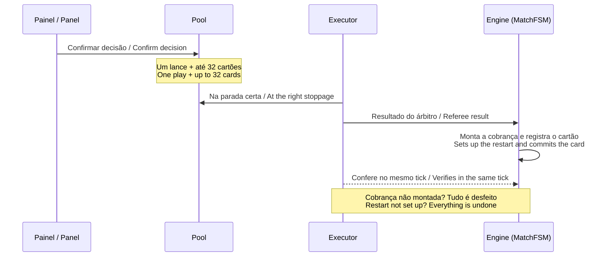

| | PT-BR | English |
| --- | --- | --- |
| **Nativo / Native** | DLL x64 em C++20 com menos de 1 MB, um único gancho de render em `GrSwapChain::Present0`, sem dispositivo DX11 extra e sem trabalho de interface fora do replay | C++20 x64 DLL under 1 MB, a single render hook on `GrSwapChain::Present0`, no extra DX11 device and no UI work outside the replay |
| **Na engine / In the engine** | Decisões entram pela máquina de estados da partida (`MatchFSM`) e pelo registro de cartões da própria engine, nos dois buffers que ela usa | Decisions go through the match state machine (`MatchFSM`) and the engine's own card commit, in both buffers it uses |
| **Atômico / Atomic** | A cobrança é conferida no mesmo tick e, se o jogo não a montou, cartões e dados da partida voltam ao estado anterior | The restart is verified in the same tick and, if the game did not set it up, cards and match data are rolled back |
| **Seguro / Safe** | Ganchos instalados com as outras threads congeladas, escrita só em estruturas validadas e correção de um defeito do alocador do jogo que derrubava o PES depois do apito final | Hooks installed with the other threads frozen, writes only to validated structures and a fix for a game allocator bug that crashed PES after the final whistle |
| **Testado / Tested** | 20 suítes, contratos conferidos no executável real, painel desenhado em 7 resoluções e tudo validado com AddressSanitizer e UndefinedBehaviorSanitizer | 20 suites, contracts checked against the real executable, the panel rendered at 7 resolutions and everything validated under AddressSanitizer and UndefinedBehaviorSanitizer |

As notas de engenharia reversa (structs, ganchos, assinaturas e a máquina de estados da partida) estão em [`re_notes/`](re_notes) e o histórico em [`CHANGELOG.md`](CHANGELOG.md).<br>
Reverse engineering notes (structs, hooks, signatures and the match state machine) are in [`re_notes/`](re_notes) and the history is in [`CHANGELOG.md`](CHANGELOG.md).

## Build & Testes / Build & Tests

Requer / Requires **LLVM-MinGW UCRT x86_64** (`x86_64-w64-mingw32-clang++`). O build compila a DLL, roda os testes e só então gera o pacote em `dist/`.<br>
The build compiles the DLL, runs the tests and only then stages the package in `dist/`.

```powershell
powershell -ExecutionPolicy Bypass -File native\build.ps1
```

Com o executável do jogo, os testes conferem as assinaturas e os contratos da engine. Com uma pasta de capturas, eles desenham o painel em 7 resoluções nos dois idiomas, e `docs/assets/make_readme_art.py` monta as imagens deste README a partir delas.<br>
With the game executable, the tests check the signatures and engine contracts. With a snapshot folder, they render the panel at 7 resolutions in both languages, and `docs/assets/make_readme_art.py` builds this README's images from them.

```powershell
$env:PES2021_EXE = "C:\Program Files (x86)\Steam\steamapps\common\eFootball PES 2021\PES2021.exe"
$env:VAR_HUD_SNAPSHOT_DIR = "$env:TEMP\var_hud"
native\build_tmp\test_var_core.exe
python docs\assets\make_readme_art.py "$env:TEMP\var_hud"
```

---

<div align="center">

Projeto independente, sem afiliação com a Konami. Nenhum arquivo do jogo é distribuído ou alterado.<br>
Independent project, not affiliated with Konami. No game file is distributed or modified.

[MIT](LICENSE) · Inclui / Includes [Dear ImGui](https://github.com/ocornut/imgui) ([MIT](native/third_party/imgui/LICENSE.txt))

</div>
