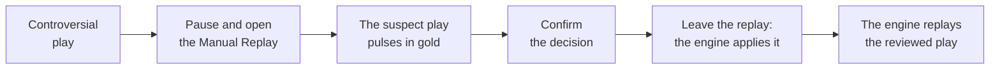
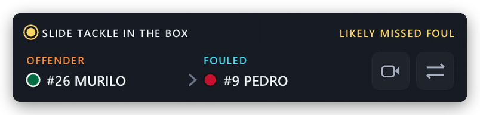
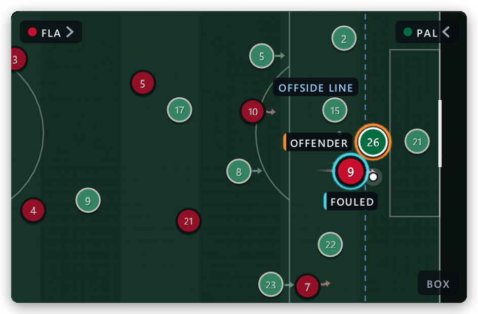
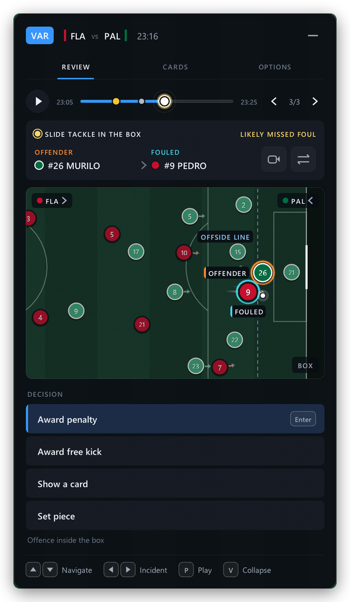
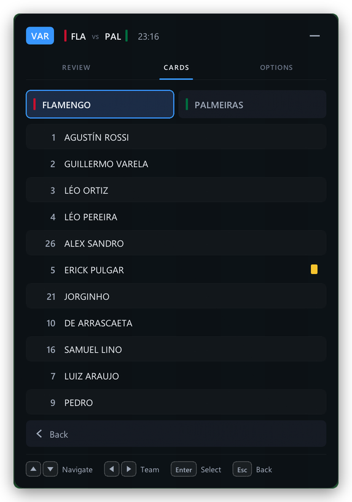
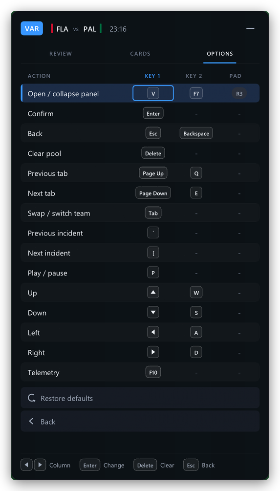
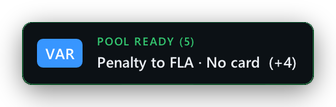
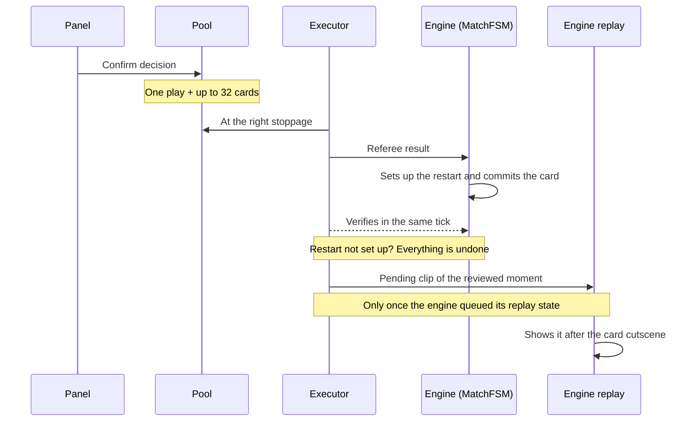

<div align="center">


-0095D9?style=for-the-badge)


**English** · [Português (BR)](README.pt-BR.md) · [Support](#support-the-project)

### [Download the latest release](https://github.com/Joao-Spala/pes21-var-mod/releases/latest)

[](https://ko-fi.com/AlfaceJao)

</div>

---

## What it is

**VAR for PES 2021** adds a manual video review to offline matches. Pause, open the replay, pick a play and decide. The decision is applied inside the PES engine, so the restart, the card and the sending off follow as if the referee had made that call from the start. When it is a foul or a penalty given with the ball in play, the engine then shows the play again.

It is a Sider module (native x64 DLL plus Lua) for the Steam version of the game.

## See it move

<p align="center"></p>

<p align="center"><sub>The replay runs and the panel follows it frame by frame. A challenge in midfield first, then the pitch zooms into the box on its own when the attack gets there. The gold marker on the bar keeps pulsing: it is the play most likely to be a foul the referee missed, a slide that floored the striker in the box.</sub></p>

## What you can do

| Situation | What the VAR does |
| --- | --- |
| **The penalty that was not given.** Your striker was brought down and play went on. | Go back to the play in the replay and pick **Award penalty**. The match goes to the spot with the card you choose, and the engine replays the reviewed play after the whistle. |
| **The unfair call.** The referee gave a foul and a yellow on a clean tackle. | Pick **Overturn foul**. The foul disappears, the card is removed and possession goes back to the right team. |
| **The wrong card.** It was a second yellow and the player stayed on, or the other way round. | Fix any player's card in the **CARDS** tab. The engine removes or restores the player at the stoppage. |

## From play to decision



The panel finds the moments that matter by itself. It follows the match 60 times per second and marks slide tackles, standing tackles, shoulder charges, falls and simulation on the replay bar, along with the referee's fouls, cards and advantages. Every marker arrives with offender, fouled player, spot and zone. Check it, adjust anything and press **Confirm decision**. The decision goes into the **decision pool** and, when you leave the replay, the engine applies everything at once.

## Up close

<table>
<tr>
<td width="50%"></td>
<td><b>The suspect play stands out.</b><br>Every play the referee let go gets a missed-foul score: the kind of challenge, whether the opponent went down from that contact, the box and how tight the contact was. The strongest one pulses in gold until you open it. Official calls and dives never qualify.</td>
</tr>
<tr>
<td></td>
<td><b>Who did what, at a glance.</b><br>Offender in orange, fouled player in cyan, colours no kit and no UI state uses. The distance tells what it measures: <i>7.8 m inside the box</i>.</td>
</tr>
<tr>
<td></td>
<td><b>A tactical board, not a radar.</b><br>Framed on the play and gliding with it, readable shirt numbers on every kit, a heading arrow on the players near the ball, a 1.5 s trail for the two players of the play and a dotted one for the ball, arrows that show which way each team attacks, the offside line, and tags that sit where they cover nobody.</td>
</tr>
</table>

**Also new in v4.4.9 and v4.4.10**

- **The camera follows the jump.** Click a play on the bar and the 3D replay camera goes to the new frame, keeping its angle and distance.
- **Replay after the decision.** A foul or penalty given with the ball in play is shown again by the engine itself, after the stoppage cutscenes. It can be turned off in **OPTIONS**.
- **Readable on any screen.** Minimum text and token sizes at 720p, 4:3 and 800x600.
- **Lighter.** Smaller font atlas with no copy left in RAM, a cheaper panel shadow and a smaller DLL.

## The panel

<table>
<tr>
<td align="center" width="33%"><br><b>Review</b><br><sub>The incident bar, the play in focus and the tactical pitch with the contact between offender and fouled player.</sub></td>
<td align="center" width="33%"><br><b>Decision</b><br><sub>Adjust player, card, team and spot. The white cross labelled RESTART is where the play restarts, one click moves it.</sub></td>
<td align="center" width="33%"><br><b>Decision pool</b><br><sub>One play and up to 32 card edits, applied together and in order when you leave the replay.</sub></td>
</tr>
<tr>
<td align="center"><br><b>Cards</b><br><sub>All 22 players with real names and numbers. Fix anyone's card, even with no play attached.</sub></td>
<td align="center"><br><b>Options</b><br><sub>Screen side, size, tactical pitch, alerts, the replay after the decision and language, saved for the next match.</sub></td>
<td align="center"><br><b>Controls</b><br><sub>Two keys per action, automatic swap on conflict and no essential shortcut ever lost.</sub></td>
</tr>
</table>

<p align="center"><br><sub>Collapsed, the panel becomes a pill that reminds you what is about to be applied.</sub></p>

## See, decide, apply, remember

| | |
| --- | --- |
| **See** | The match recorded at 60 Hz, one frame per simulation frame, so the pitch follows the replay frame by frame and blends positions in slow motion. Incidents come from the engine's own contact model, and a foul whistled after an advantage sits at the moment of contact. Names, numbers and kits come from game memory, including patch-edited ones. |
| **Decide** | Award a foul or penalty on an earlier play, overturn the foul or penalty given, upgrade to penalty, reverse the foul, edit cards and award a corner, goal kick or throw-in, even with the kicker already over the ball. |
| **Apply** | The card goes through the engine's own commit, which counts it once, and the sending off follows the engine's flow. If the game does not set up the restart, the mod undoes everything it wrote at that moment. For a foul or penalty given with the ball in play, the engine then replays the reviewed moment through its own replay of past plays. |
| **Remember** | Cards and fouls follow the player of the play, not the slot, even after a substitution. A decision about a stoppage that has already passed is never applied out of time. |
| **Respect** | Never a third yellow or a second red. No game file is modified. The panel takes the same share of the screen from 720p to 4K, ultrawide and 4:3, in Compact, Default and Large sizes. |

## Limitations

- It only works on **Steam PES 2021 `v1.7.2.0`**. Other executable versions use other addresses and are not supported.
- **Offline matches only**: Exhibition, Master League, Become a Legend and Cups. Nothing related to network, DRM or online modes is touched.
- It does not rewind the match. A decision applies to the stoppage it was made in, and **goals cannot be overturned**.
- The replay after the decision is for a foul or penalty given with the ball in play, with the reviewed moment still in the game's replay memory (about 11 s of play). The engine may show its own instant replay first. When any condition is missing, the decision is applied without the extra replay.
- The gamepad opens and collapses the panel and keeps controlling the replay. Inside the panel, navigation is keyboard and mouse.

## Installation

1. Download **`PES2021_VAR_Mod_v4.4.10.zip`** from [**Releases**](https://github.com/Joao-Spala/pes21-var-mod/releases/latest) and extract it anywhere.
2. With the game closed, run **`VAR_Mod_Gerenciar.bat`** and pick **`1 - Instalar ou atualizar`** (install or update).
3. Launch the game through **Sider** (with a patch, through the patch launcher). Done.

The installer finds Sider by itself (or asks for the path), makes a timestamped backup of `sider.ini` before any change and touches nothing while the game is open. The DLL only loads on the first match, so game startup stays the same.

<details>
<summary><b>Installer options, manual install and requirements</b></summary>

| Option | What it does |
| --- | --- |
| **1 - Install or update** | Copies the new version and enables the mod in `sider.ini` |
| **2 - Enable** | Turns the mod back on without copying anything |
| **3 - Disable** | Turns the mod off and keeps the files |
| **4 - Uninstall** | Keeps your `var_mod.ini` (shortcuts and language) next to `sider.ini`, deletes the files and the mod's line and keeps `luajit.ext.enabled = 1`, which other modules also use |

**Manual:** copy `modules\var_mod.lua` to `<sider folder>\modules\` and `modules\var_mod\var_core.dll` to `<sider folder>\modules\var_mod\`. Then add to `sider.ini`:

```ini
lua.enabled = 1
luajit.ext.enabled = 1
lua.module = "var_mod.lua"
```

**Requirements:** Steam PES 2021 `v1.7.2.0`, Sider 7.3+ with LuaJIT (standalone or inside a patch) and Windows 10 or 11 x64.

</details>

## Shortcuts

| Action | Keyboard | Gamepad |
| --- | --- | --- |
| Open or collapse the panel | `V` or `F7` | `R3` |
| Confirm / Back | `Enter` / `Esc` or `Backspace` | |
| Previous / next tab | `Page Up` or `Q` / `Page Down` or `E` | |
| Previous / next incident | `[` / `]` | |
| Swap roles or switch team | `Tab` | |
| Replay Play / Pause | `P` | |
| Navigate | Arrow keys or `W` `A` `S` `D` | |
| Clear the pool | `Delete` | |
| Telemetry | `F10` | |

All remappable in **OPTIONS > Controls**. While the panel is focused, keyboard and mouse never reach the game. In the Sider menu, key **`7`** turns the VAR on or off and **`8`** shows live telemetry.

<details>
<summary><b>Troubleshooting</b></summary>

| Symptom | What to do |
| --- | --- |
| **The Sider menu shows `Status: ERROR (...)`** | The DLL did not load and the text gives the reason. Check that `var_core.dll` is in `<sider folder>\modules\var_mod\`, that `lua.enabled = 1` and `luajit.ext.enabled = 1` are in `sider.ini`, and look at `sider.log`. |
| **The panel does not open in the replay** | Make sure the match is offline and the VAR is on (key `7` in the Sider menu). `V`, `F7` or `R3` reopen a collapsed panel. |
| **No replay after a decision** | It only follows a foul or penalty given with the ball in play, and it can be off in **OPTIONS**. Otherwise the log says why in a `Decision replay: ...` line (the moment had left the replay memory, the engine queued no replay for that stoppage or its replay slot was busy). |
| **Something went wrong in a match** | The log is at `<sider folder>\modules\var_mod\var_core.log` and is recreated every time the game starts. Copy it before relaunching and attach it to an [issue](https://github.com/Joao-Spala/pes21-var-mod/issues). |
| **Back to defaults** | Delete `<sider folder>\modules\var_mod\var_mod.ini`. |

</details>

---

## Under the hood

A mod that writes into the memory of a closed game only deserves trust if it is predictable. These are the engineering choices behind it.



| | |
| --- | --- |
| **Native** | C++20 x64 DLL of about 780 KB, a single render hook on `GrSwapChain::Present0`, no extra DX11 device and no UI work outside the replay. Measured on the real code paths in a benchmark: 3 to 6 µs per simulation tick and 2 µs per frame. |
| **In the engine** | Decisions go through the match state machine (`MatchFSM`) and the engine's own card commit, in both buffers it uses. The replay after the decision is the engine's own pending clip, filled field by field like its builder does. |
| **Atomic** | The restart is verified in the same tick and, if the game did not set it up, cards and match data are rolled back. A replay request nobody consumes goes back to idle on its own. |
| **Safe** | Hooks installed with the other threads frozen, writes only to validated structures, a fix for a game allocator bug that crashed PES after the final whistle and a cache that keeps that fix cheap during loading. |
| **Tested** | 23 suites, contracts checked against the real executable, the panel rendered at 7 resolutions in both languages and everything validated under AddressSanitizer and UndefinedBehaviorSanitizer. |

Reverse engineering notes (structs, hooks, signatures and the match state machine) are in [`re_notes/`](re_notes) and the history is in [`CHANGELOG.md`](CHANGELOG.md).

## Build & Tests

Requires **LLVM-MinGW UCRT x86_64** (`x86_64-w64-mingw32-clang++`). The build compiles the DLL, runs the tests and only then stages the package in `dist/`.

```powershell
powershell -ExecutionPolicy Bypass -File native\build.ps1
```

With the game executable, the tests check the signatures and engine contracts. With a snapshot folder they render the panel at 7 resolutions in both languages, with `VAR_HUD_SEQUENCE` also the replay sequence, and `docs/assets/make_readme_art.py` builds every image and the animation of this README from them.

```powershell
$env:PES2021_EXE = "C:\Program Files (x86)\Steam\steamapps\common\eFootball PES 2021\PES2021.exe"
$env:VAR_HUD_SNAPSHOT_DIR = "$env:TEMP\var_hud"
$env:VAR_HUD_SEQUENCE = "1"
native\build_tmp\test_var_core.exe
python docs\assets\make_readme_art.py "$env:TEMP\var_hud"
```

---

## Support the project

This mod is free and open source, and it always will be. If it made your matches better and you feel like buying me a coffee, I would really appreciate it. A bug report or a thank you means just as much.

[](https://ko-fi.com/AlfaceJao)

Brazilian? There is a Pix QR code in the [Portuguese README](README.pt-BR.md#apoie-o-projeto).

---

<div align="center">

Independent project, not affiliated with Konami. No game file is distributed or modified.

[MIT](LICENSE) · Includes [Dear ImGui](https://github.com/ocornut/imgui) ([MIT](native/third_party/imgui/LICENSE.txt))

</div>
