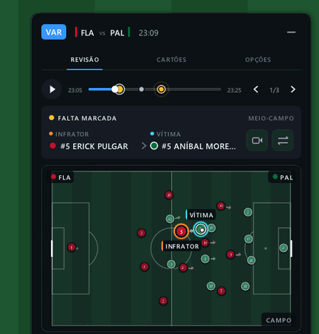
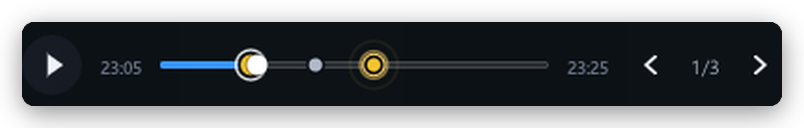
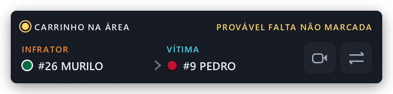
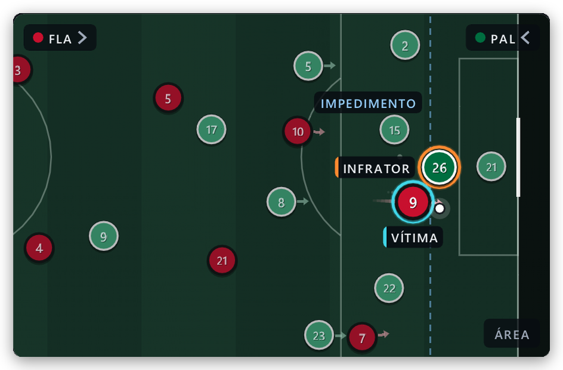
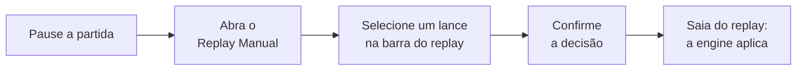
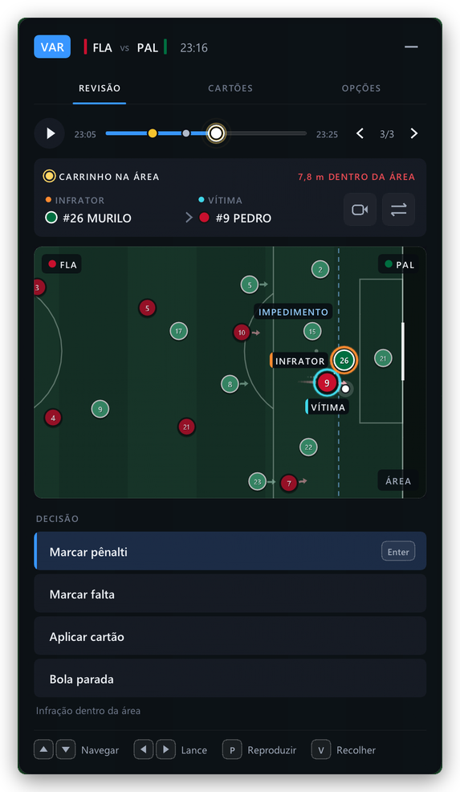
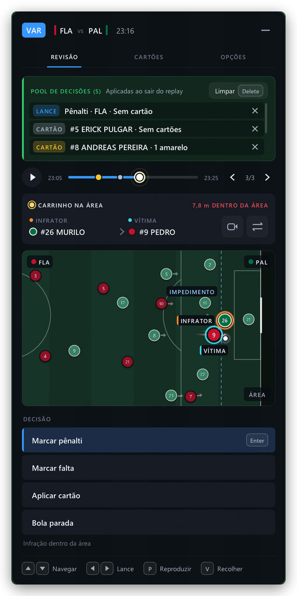
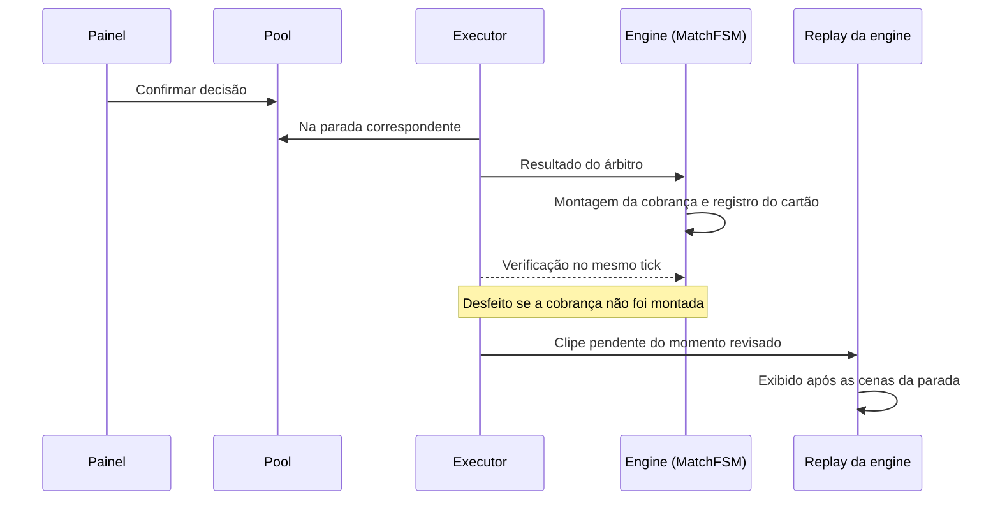

<div align="center">


-0095D9?style=for-the-badge)


[English](README.md) · **Português (BR)** · [Apoie](#apoie-o-projeto)

### [Baixar a última versão](https://github.com/Joao-Spala/pes21-var-mod/releases/latest)

[](https://ko-fi.com/AlfaceJao) [](#apoie-o-projeto)

</div>

---

## Visão geral

O VAR para PES 2021 é um módulo de revisão de vídeo para partidas offline do eFootball PES 2021 (Steam `v1.7.2.0`). Ele adiciona um painel de revisão ao Replay Manual. As decisões confirmadas ali são aplicadas pela própria engine do jogo: cobranças, cartões e expulsões seguem o fluxo da engine.

É distribuído como módulo do Sider: uma DLL nativa x64 e um script Lua.

## Demonstração

<p align="center"></p>

<p align="center"><sub>Painel de revisão durante o Replay Manual. O campinho tático acompanha o replay quadro a quadro e o marcador dourado indica o lance com a maior nota de falta não marcada.</sub></p>

## Funcionalidades

| Área | Descrição |
| --- | --- |
| **Detecção de lances** | A partida é amostrada a 60 Hz. Carrinhos, botes, trancos, quedas e simulações são marcados na barra do replay junto com as faltas, cartões e vantagens do árbitro, cada um com infrator, vítima, local e zona. |
| **Indicador de falta não marcada** | Os lances que o árbitro não puniu recebem uma nota pelo tipo de entrada, se o adversário caiu pelo contato, posição em relação à área e distância do contato. A maior nota é destacada na barra do replay e indicada no cartão do lance. |
| **Decisões** | Marcar falta ou pênalti num lance anterior, anular falta ou pênalti, converter em pênalti, inverter a falta, ajustar os cartões de qualquer jogador e dar escanteio, tiro de meta ou lateral. |
| **Pool de decisões** | Uma decisão de lance e até 32 ajustes de cartão, aplicados juntos e em ordem ao sair do replay. |
| **Integração com a engine** | As decisões passam pela máquina de estados da partida (`MatchFSM`) e pelo registro de cartões da própria engine. Se a engine não montar a cobrança, todas as alterações daquele tick são desfeitas. |
| **Replay após a decisão** | Numa falta ou pênalti marcado com a bola rolando, a engine repete o momento revisado depois das cenas da parada, pelo próprio mecanismo de clipe pendente. Pode ser desligado. |
| **Campinho tático** | Enquadramento automático (lance ou área), números das camisas, setas de direção, rastro de 1,5 s dos dois jogadores envolvidos e da bola, sentido de ataque de cada time, linha de impedimento e local da cobrança. |
| **Câmera do replay** | Selecionar um lance na barra leva a câmera 3D do replay até aquele quadro. |
| **Identidade dos jogadores** | Nomes, números e uniformes lidos da memória do jogo, inclusive dados editados por patches. Cartões e faltas seguem o jogador, não a posição, mesmo após substituições. |
| **Interface** | PT-BR e inglês. Escala de 720p a 4K, ultrawide e 4:3, em três tamanhos. Teclado e mouse dentro do painel. |

## Detalhes

<table>
<tr>
<td width="50%"></td>
<td><b>Barra do replay.</b> Marcadores das decisões oficiais e dos lances detectados. O marcador dourado é o indicador de falta não marcada.</td>
</tr>
<tr>
<td></td>
<td><b>Cartão do lance.</b> Tipo de lance, distância até a área, infrator (laranja) e vítima (ciano).</td>
</tr>
<tr>
<td></td>
<td><b>Campinho tático.</b> Posições no quadro do replay, setas de direção, rastros, linha de impedimento e rótulos dos papéis.</td>
</tr>
</table>

## Fluxo de uso



O painel abre automaticamente no Replay Manual. Os lances detectados já trazem infrator, vítima, local e zona preenchidos, que podem ser ajustados antes de confirmar. As decisões confirmadas ficam no pool de decisões e são aplicadas ao fechar o replay.

## Capturas de tela

<table>
<tr>
<td align="center" width="33%"><br><b>Revisão</b><br><sub>Barra do replay, cartão do lance e campinho tático.</sub></td>
<td align="center" width="33%"><br><b>Decisão</b><br><sub>Cartão, time da cobrança, jogador e local da cobrança.</sub></td>
<td align="center" width="33%"><br><b>Pool de decisões</b><br><sub>Decisões pendentes, aplicadas ao sair do replay.</sub></td>
</tr>
<tr>
<td align="center"><br><b>Cartões</b><br><sub>Os 22 jogadores com nomes e números.</sub></td>
<td align="center"><br><b>Opções</b><br><sub>Configurações do painel, da partida e do idioma.</sub></td>
<td align="center"><br><b>Controles</b><br><sub>Duas teclas por ação.</sub></td>
</tr>
</table>

## Requisitos

| Item | Versão |
| --- | --- |
| Jogo | eFootball PES 2021 `v1.7.2.0` (Steam). Outras versões do executável não são suportadas. |
| Sider | 7.3 ou posterior com LuaJIT, sozinho ou dentro de um patch |
| Sistema | Windows 10 ou 11, x64 |

## Instalação

Feche o jogo, baixe o **`PES2021_VAR_Mod_v4.4.12.zip`** em [Releases](https://github.com/Joao-Spala/pes21-var-mod/releases/latest) e extraia. Depois instale à mão (opção A) ou com o script de instalação (opção B). As duas dão o mesmo resultado.

### Opção A: instalação manual

1. Encontre a **pasta do Sider**: a pasta que tem o `sider.dll`. Num patch, normalmente é a própria pasta do patch. Com o Sider avulso, é onde você extraiu o Sider.
2. Copie a pasta `modules` do pacote para dentro da pasta do Sider, para ficar assim:
   ```text
   <pasta do Sider>\modules\var_mod.lua
   <pasta do Sider>\modules\var_mod\var_core.dll
   ```
3. Faça uma cópia do `<pasta do Sider>\sider.ini`, abra o arquivo num editor de texto e garanta que estas três linhas existam. Se `lua.enabled` ou `luajit.ext.enabled` já existirem com `= 0`, troque para `= 1`. Coloque a linha `lua.module` junto das outras linhas `lua.module`. Se a pasta também tiver variantes `sider-<nome>.ini` que um launcher alterna, faça o mesmo em cada uma.
   ```ini
   lua.enabled = 1
   luajit.ext.enabled = 1
   lua.module = "var_mod.lua"
   ```
4. Abra o jogo pelo Sider (ou pelo atalho do patch). O mod carrega na primeira partida.

Para **desativar**, coloque um `;` no começo da linha `lua.module = "var_mod.lua"`. Para **desinstalar**, apague essa linha, o `modules\var_mod.lua` e a pasta `modules\var_mod\` (suas configurações ficam em `modules\var_mod\var_mod.ini`).

### Opção B: script de instalação

Rode o **`VAR_Mod_Setup.bat`** e escolha **`1 - Install or update`**. Ele executa o `VAR_Mod_Setup.ps1`, um script PowerShell em texto puro que pode ser aberto no Bloco de Notas antes de rodar. O cabeçalho lista tudo o que ele faz: encontra a pasta do Sider (ou pergunta), copia os dois arquivos, edita o `sider.ini` e as variantes `sider-<nome>.ini` como na opção A depois de salvar um backup datado de cada um e não altera nada com o jogo aberto. Sem acesso à rede e sem alterar o registro.

| Opção | Ação |
| --- | --- |
| **1 - Install or update** | Copia os arquivos e ativa o mod no `sider.ini` |
| **2 - Enable** | Grava as mesmas linhas no `sider.ini` sem copiar arquivos |
| **3 - Disable** | Comenta a linha do mod no `sider.ini` e mantém os arquivos |
| **4 - Uninstall** | Salva suas configurações como `var_mod.ini.before-uninstall-<data>.bak` ao lado do `sider.ini` e depois remove a linha do mod, o `modules\var_mod.lua` e a pasta `modules\var_mod\`. `lua.enabled` e `luajit.ext.enabled` continuam em 1 |

## Opções

As configurações ficam em `<pasta do sider>\modules\var_mod\var_mod.ini`.

| Opção | Padrão |
| --- | --- |
| Abrir no replay | Ligado |
| Campo tático | Ligado |
| Zoom automático na área | Ligado |
| Posição | Direita |
| Tamanho (Compacto, Padrão, Grande) | Padrão |
| Alertas durante o jogo | Ligado |
| Replay do lance após a decisão | Ligado |
| Idioma | Português (BR) |
| Controles | Duas teclas por ação, remapeáveis |

## Atalhos

| Ação | Teclado | Controle |
| --- | --- | --- |
| Abrir ou recolher o painel | `V` ou `F7` | `R3` |
| Confirmar / Voltar | `Enter` / `Esc` ou `Backspace` | |
| Aba anterior / próxima | `Page Up` ou `Q` / `Page Down` ou `E` | |
| Lance anterior / próximo | `[` / `]` | |
| Inverter papéis ou trocar time | `Tab` | |
| Play / pause do replay | `P` | |
| Navegar | Setas ou `W` `A` `S` `D` | |
| Limpar o pool | `Delete` | |
| Telemetria | `F10` | |

Todos os atalhos podem ser alterados em **OPÇÕES > Controles**. Com o painel em foco, teclado e mouse não chegam ao jogo. No menu do Sider, `7` liga e desliga o mod e `8` mostra a telemetria ao vivo.

## Limitações

- Suporta apenas o executável Steam `v1.7.2.0`.
- Apenas partidas offline: Exibição, Master Liga, Rumo ao Estrelato e Copas. Rede, DRM e modos online não são tocados.
- Uma decisão vale para a parada em que foi tomada. Gols não podem ser anulados.
- O replay após a decisão exige falta ou pênalti marcado com a bola rolando e o momento revisado ainda na memória de replay do jogo (cerca de 11 s de jogo). O replay instantâneo da engine pode ser exibido antes.
- O controle abre e recolhe o painel e controla o replay. A navegação dentro do painel usa teclado e mouse.

## Solução de problemas

| Sintoma | Ação |
| --- | --- |
| Menu do Sider mostra `Status: ERRO (...)` | A DLL não carregou. Confira se o `var_core.dll` está em `<pasta do sider>\modules\var_mod\`, se `lua.enabled = 1` e `luajit.ext.enabled = 1` estão no `sider.ini` e consulte o `sider.log`. |
| O painel não abre no replay | Confirme que a partida é offline e que o mod está ligado (`7` no menu do Sider). `V`, `F7` ou `R3` reabrem o painel recolhido. |
| Não houve replay após a decisão | Vale apenas para falta ou pênalti com a bola rolando e pode estar desligado em **OPÇÕES**. Fora isso, uma linha `Decision replay: ...` no log informa o motivo. |
| Comportamento inesperado numa partida | O log é `<pasta do sider>\modules\var_mod\var_core.log` e é recriado a cada abertura do jogo. Copie-o antes de reabrir o jogo e anexe numa [issue](https://github.com/Joao-Spala/pes21-var-mod/issues). |
| Restaurar configurações | Apague `<pasta do sider>\modules\var_mod\var_mod.ini`. |

---

## Visão técnica



| | |
| --- | --- |
| **Binário** | DLL x64 em C++20, cerca de 780 KB. Um único gancho de render em `GrSwapChain::Present0`, sem dispositivo DX11 adicional e sem trabalho de interface fora do replay. |
| **Custo** | Medido nos caminhos reais do código num benchmark: 3 a 6 µs por tick da simulação e 2 µs por quadro. Histórico da partida de 30 s (cerca de 0,87 MB). |
| **Segurança** | Ganchos instalados com as demais threads suspensas. Escritas apenas em estruturas validadas. Inclui correção de um defeito do alocador da engine que derrubava o jogo após o apito final. |
| **Testes** | 23 suítes, incluindo verificação de contratos no executável real e renderização do painel em 7 resoluções nos dois idiomas, também executadas com AddressSanitizer e UndefinedBehaviorSanitizer. |

As notas de engenharia reversa estão em [`re_notes/`](re_notes), o histórico de versões em [`CHANGELOG.md`](CHANGELOG.md) e as instruções de build e testes no [README em inglês](README.md#build-and-tests).

---

## Apoie o projeto

<table>
<tr>
<td width="160" align="center"></td>
<td>

O mod é gratuito e de código aberto. Doações são bem-vindas e opcionais. Relatos de bug são igualmente úteis.

**Pix:** escaneie o QR ou use a chave aleatória `925fd607-2011-4ca2-83a4-b3cf145b408b`<br>
**Fora do Brasil:** [](https://ko-fi.com/AlfaceJao)

</td>
</tr>
</table>

---

<div align="center">

Projeto independente, sem afiliação com a Konami. Nenhum arquivo do jogo é distribuído ou alterado.

[MIT](LICENSE) · Inclui [Dear ImGui](https://github.com/ocornut/imgui) ([MIT](native/third_party/imgui/LICENSE.txt))

</div>
