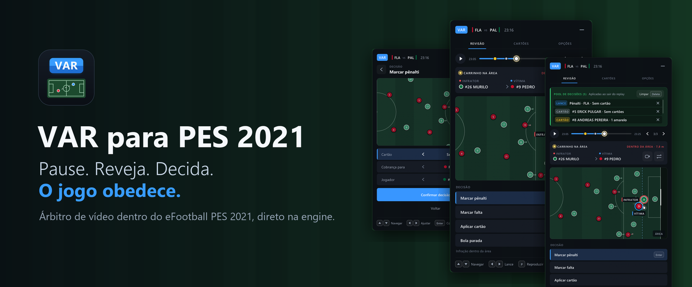
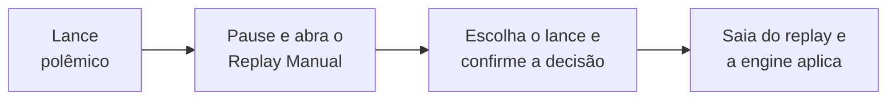
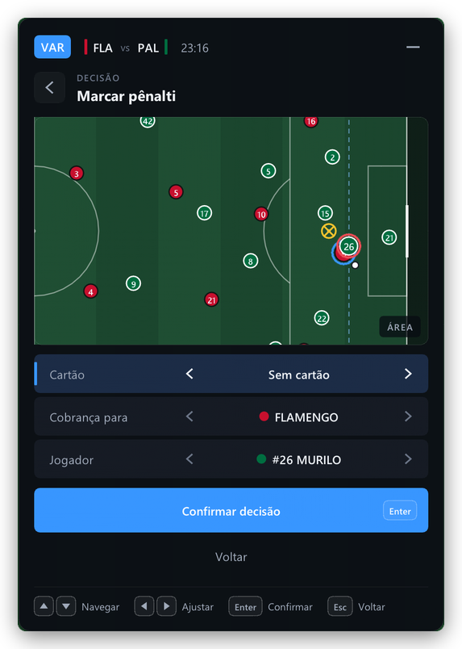
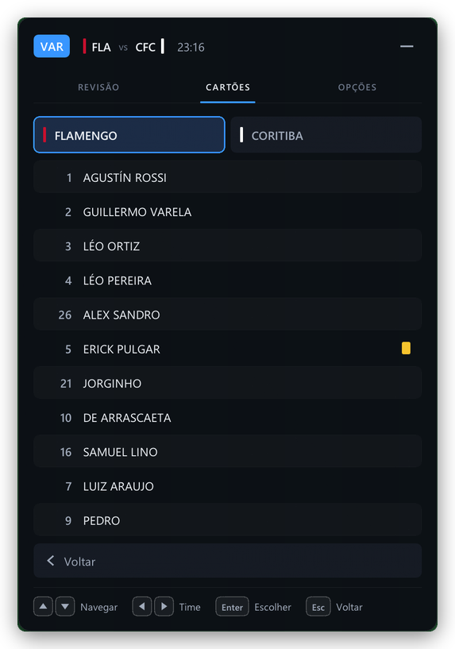
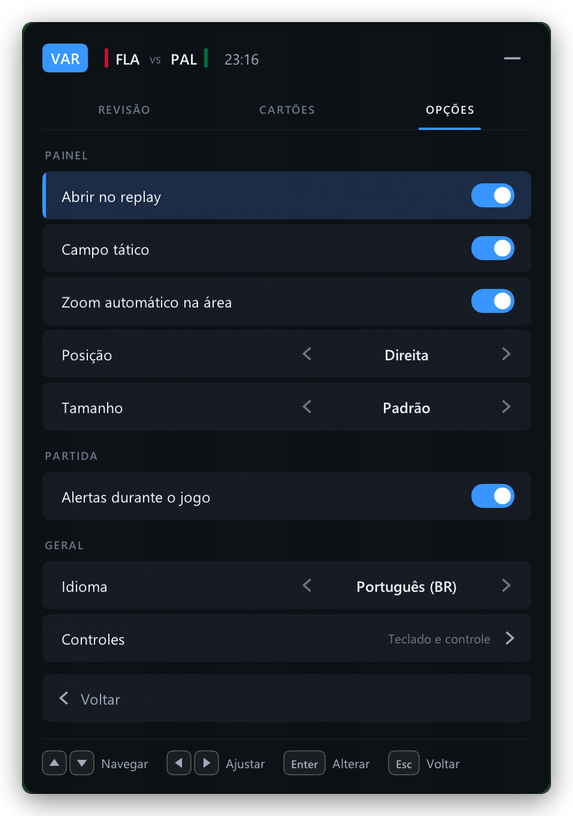
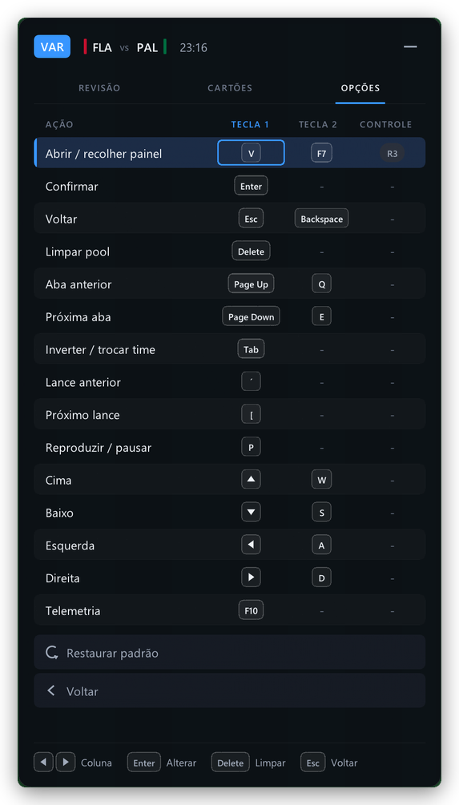
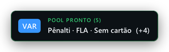
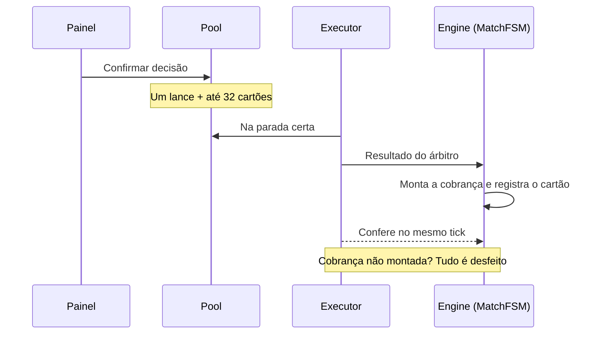

<div align="center">




-0095D9?style=for-the-badge)


[English](README.md) · **Português (BR)** · [Apoie](#apoie-o-projeto)

### [Baixar a última versão](https://github.com/Joao-Spala/pes21-var-mod/releases/latest)

[](https://ko-fi.com/AlfaceJao) [](#apoie-o-projeto)

</div>

---

## O que é

O **VAR para PES 2021** adiciona uma revisão manual de vídeo às partidas offline. Você pausa, abre o replay, escolhe o lance e decide. A decisão é aplicada dentro da engine do PES, então a cobrança, o cartão e a expulsão seguem como se o árbitro tivesse tomado aquela decisão desde o começo.

É um módulo do Sider (DLL nativa x64 e Lua) para a versão Steam do jogo.

## O que você pode fazer

| Situação | O que o VAR faz |
| --- | --- |
| **O pênalti que não foi marcado.** Seu atacante foi derrubado e o jogo seguiu. | Volte ao lance no replay e escolha **Marcar pênalti**. A partida vai para a marca da cal, com o cartão que você decidir. |
| **A marcação injusta.** O árbitro deu falta e amarelo num lance limpo. | Escolha **Anular falta**. A falta some, o cartão é retirado e a posse volta para o time certo. |
| **O cartão errado.** Era o segundo amarelo e o jogador ficou em campo, ou o contrário. | Ajuste o cartão de qualquer jogador na aba **CARTÕES**. A engine tira ou devolve o jogador na bola parada. |

## Do lance à decisão



O painel encontra sozinho os momentos que importam. Ele acompanha a partida 60 vezes por segundo e marca na barra do replay carrinhos, botes, trancos, quedas e simulações, além das faltas, cartões e vantagens do árbitro. Cada marcador já chega com infrator, vítima, local e zona (dentro ou fora da área). Você confere, ajusta o que quiser e aperta **Confirmar decisão**. A decisão vai para o **pool de decisões** e, ao sair do replay, a engine aplica tudo de uma vez.

## O painel

<table>
<tr>
<td align="center" width="33%"><br><b>Revisão</b><br><sub>A barra de lances, o lance em foco e o campo tático com o contato entre infrator e vítima.</sub></td>
<td align="center" width="33%"><br><b>Decisão</b><br><sub>Ajuste jogador, cartão, time e local. Um clique no campo move a cobrança.</sub></td>
<td align="center" width="33%"><br><b>Pool de decisões</b><br><sub>Um lance e até 32 ajustes de cartão, aplicados juntos e em ordem ao sair do replay.</sub></td>
</tr>
<tr>
<td align="center"><br><b>Cartões</b><br><sub>Os 22 jogadores com nomes e números reais. Corrija o cartão de qualquer um, mesmo sem lance.</sub></td>
<td align="center"><br><b>Opções</b><br><sub>Lado da tela, tamanho, campo tático, avisos e idioma, salvos para a próxima partida.</sub></td>
<td align="center"><br><b>Controles</b><br><sub>Duas teclas por ação, troca automática em conflito e nenhum atalho essencial perdido.</sub></td>
</tr>
</table>

<p align="center"><br><sub>Recolhido, o painel vira uma pílula que lembra o que vai ser aplicado.</sub></p>

## Ver, decidir, aplicar, lembrar

| | |
| --- | --- |
| **Ver** | Detecção de lances a 60 Hz com o modelo de contato da própria engine. A falta apitada depois de uma vantagem fica no momento do contato, não no apito. Nomes, números e uniformes vêm da memória do jogo, inclusive os editados por patches. |
| **Decidir** | Marcar falta ou pênalti num lance anterior, anular a falta ou o pênalti marcado, converter em pênalti, inverter a falta, ajustar cartões e dar escanteio, tiro de meta ou lateral, mesmo com o cobrador já posicionado. |
| **Aplicar** | O cartão passa pelo registro da própria engine, que conta uma vez só, e a expulsão sai pelo fluxo dela. Se o jogo não montar a cobrança, o mod desfaz tudo o que escreveu naquele instante. |
| **Lembrar** | Cartões e faltas seguem o jogador do lance, não a posição, mesmo depois de uma substituição. Uma decisão sobre uma parada que já passou nunca é aplicada fora de hora. |
| **Respeitar** | Nunca terceiro amarelo nem segundo vermelho. Nenhum arquivo do jogo é alterado. O painel ocupa a mesma fração da tela de 720p a 4K, em ultrawide e 4:3, nos tamanhos Compacto, Padrão e Grande. |

## Limitações

- Funciona só no **PES 2021 `v1.7.2.0` da Steam**. Outras versões do executável têm outros endereços e não são suportadas.
- **Só partidas offline**: Exibição, Master Liga, Rumo ao Estrelato e Copas. Nada de rede, DRM ou modo online é tocado.
- Não volta o jogo no tempo. Uma decisão vale para a parada em que foi tomada, e **gols não podem ser anulados**.
- O controle abre e recolhe o painel e continua controlando o replay. Dentro do painel, a navegação é por teclado e mouse.

## Instalação

1. Baixe o **`PES2021_VAR_Mod_v4.4.8.zip`** em [**Releases**](https://github.com/Joao-Spala/pes21-var-mod/releases/latest) e extraia em qualquer pasta.
2. Com o jogo fechado, rode o **`VAR_Mod_Gerenciar.bat`** e escolha **`1 - Instalar ou atualizar`**.
3. Abra o jogo pelo **Sider** (num patch, pelo atalho do próprio patch). Pronto.

O instalador acha o Sider sozinho (ou pergunta o caminho), faz backup datado do `sider.ini` antes de qualquer mudança e não mexe em nada com o jogo aberto. A DLL só carrega na primeira partida, então a abertura do jogo continua igual.

<details>
<summary><b>Opções do instalador, instalação manual e requisitos</b></summary>

| Opção | O que faz |
| --- | --- |
| **1 - Instalar ou atualizar** | Copia a versão nova e ativa o mod no `sider.ini` |
| **2 - Ativar** | Volta a ligar o mod sem copiar nada |
| **3 - Desativar** | Desliga o mod e mantém os arquivos |
| **4 - Desinstalar** | Guarda seu `var_mod.ini` (atalhos e idioma) ao lado do `sider.ini`, apaga os arquivos e a linha do mod e mantém `luajit.ext.enabled = 1`, que outros módulos também usam |

**Manual:** copie `modules\var_mod.lua` para `<pasta do sider>\modules\` e `modules\var_mod\var_core.dll` para `<pasta do sider>\modules\var_mod\`. Depois adicione ao `sider.ini`:

```ini
lua.enabled = 1
luajit.ext.enabled = 1
lua.module = "var_mod.lua"
```

**Requisitos:** PES 2021 `v1.7.2.0` (Steam), Sider 7.3+ com LuaJIT (sozinho ou dentro de um patch) e Windows 10 ou 11 x64.

</details>

## Atalhos

| Ação | Teclado | Controle |
| --- | --- | --- |
| Abrir ou recolher o painel | `V` ou `F7` | `R3` |
| Confirmar / Voltar | `Enter` / `Esc` ou `Backspace` | |
| Aba anterior / próxima | `Page Up` ou `Q` / `Page Down` ou `E` | |
| Lance anterior / próximo | `[` / `]` | |
| Inverter papéis ou trocar time | `Tab` | |
| Play / Pause do replay | `P` | |
| Navegar | Setas ou `W` `A` `S` `D` | |
| Limpar o pool | `Delete` | |
| Telemetria | `F10` | |

Todos remapeáveis em **OPÇÕES > Controles**. Enquanto o painel está em foco, teclado e mouse não chegam ao jogo. No menu do Sider, a tecla **`7`** liga e desliga o VAR e a **`8`** mostra a telemetria ao vivo.

<details>
<summary><b>Solução de problemas</b></summary>

| Sintoma | O que fazer |
| --- | --- |
| **O menu do Sider mostra `Status: ERRO (...)`** | A DLL não carregou e o texto diz o motivo. Confira se `var_core.dll` está em `<pasta do sider>\modules\var_mod\`, se `lua.enabled = 1` e `luajit.ext.enabled = 1` estão no `sider.ini` e veja o `sider.log`. |
| **O painel não abre no replay** | Confirme que a partida é offline e que o VAR está ligado (tecla `7` no menu do Sider). `V`, `F7` ou `R3` reabrem o painel recolhido. |
| **Algo deu errado numa partida** | O log fica em `<pasta do sider>\modules\var_mod\var_core.log` e é recriado a cada abertura do jogo. Copie antes de abrir de novo e anexe numa [issue](https://github.com/Joao-Spala/pes21-var-mod/issues). |
| **Voltar ao padrão** | Apague `<pasta do sider>\modules\var_mod\var_mod.ini`. |

</details>

---

## Por dentro

Um mod que escreve na memória de um jogo fechado só merece confiança se for previsível. Estas são as escolhas de engenharia que sustentam isso.



| | |
| --- | --- |
| **Nativo** | DLL x64 em C++20 com menos de 1 MB, um único gancho de render em `GrSwapChain::Present0`, sem dispositivo DX11 extra e sem trabalho de interface fora do replay. |
| **Na engine** | Decisões entram pela máquina de estados da partida (`MatchFSM`) e pelo registro de cartões da própria engine, nos dois buffers que ela usa. |
| **Atômico** | A cobrança é conferida no mesmo tick e, se o jogo não a montou, cartões e dados da partida voltam ao estado anterior. |
| **Seguro** | Ganchos instalados com as outras threads congeladas, escrita só em estruturas validadas e correção de um defeito do alocador do jogo que derrubava o PES depois do apito final. |
| **Testado** | 20 suítes, contratos conferidos no executável real, painel desenhado em 7 resoluções e tudo validado com AddressSanitizer e UndefinedBehaviorSanitizer. |

As notas de engenharia reversa estão em [`re_notes/`](re_notes), o histórico em [`CHANGELOG.md`](CHANGELOG.md) e as instruções de build e testes no [README em inglês](README.md#build--tests).

---

## Apoie o projeto

<table>
<tr>
<td width="160" align="center"></td>
<td>

Este mod é gratuito e de código aberto, e vai continuar assim. Se ele melhorou suas partidas e você quiser me pagar um café, vou ficar muito agradecido. Um relato de bug ou um obrigado vale tanto quanto.

**Pix:** escaneie o QR ou use a chave aleatória `925fd607-2011-4ca2-83a4-b3cf145b408b`<br>
**De fora do Brasil:** [](https://ko-fi.com/AlfaceJao)

</td>
</tr>
</table>

---

<div align="center">

Projeto independente, sem afiliação com a Konami. Nenhum arquivo do jogo é distribuído ou alterado.

[MIT](LICENSE) · Inclui [Dear ImGui](https://github.com/ocornut/imgui) ([MIT](native/third_party/imgui/LICENSE.txt))

</div>
